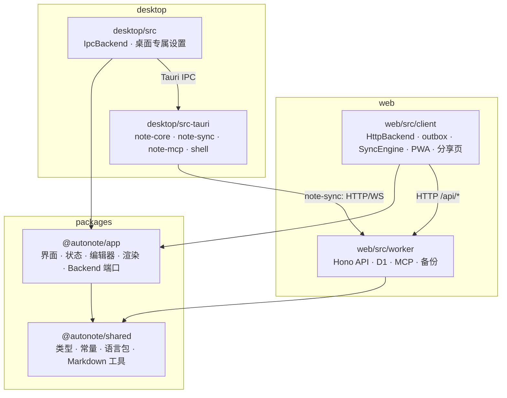

# 02 概要设计

> 状态：全阶段设计基线；描述目标实现，不代表代码已完成。实施状态仅以 `03-开发任务清单.md` 为准。
> 读者：写详细设计的人，以及按任务清单执行开发的模型。
> 每个模块内部的写法（面向接口/面向对象、日志、异常、TS、Svelte 5、Tauri 2、Hono 4、Rust 规范）见 `04-工程规范.md`。本文只定义模块之间的边界。
> 本文定义模块边界；完整实现设计见 `10/11/20/21/22-详细设计-*.md`，执行顺序见 `03-开发任务清单.md`。
> 本文 §4 到 §8 是跨模块契约。要改其中任何一条，必须先改本文，再同步修改所有依赖它的详细设计，见 §12。

## 1. 一句话架构

整个产品是**一套界面加两种后端**。`packages/app` 包含全部 Svelte 界面、客户端状态、编辑器和 Markdown 渲染管线，它只依赖一个抽象的 `Backend` 端口。Web 用 HTTP 实现这个端口，同时负责离线 outbox 和多标签页同步；桌面用 Tauri IPC 实现，由 Rust 内核负责持久化。



唯一的规则：**界面层只认 `Backend` 端口**。任何 `.svelte` 组件和状态类都不能直接调用 `fetch`、`@tauri-apps/api` 或 IndexedDB。一旦违反，同一个功能就要在两端各写一份，桌面和 Web 的行为也会逐渐不一致。

## 2. 包与目录

| 目录 | 包名 | 职责 | 明确不做 |
| --- | --- | --- | --- |
| `packages/shared` | `@autonote/shared` | 前后端共用的纯 TS：类型、常量、中英文语言包、Markdown 纯函数、zip、备份格式 | 不依赖 DOM、Svelte 或任何运行时 |
| `packages/app` | `@autonote/app` | Svelte 5 界面、runes 状态类、CodeMirror 扩展、markdown-it 渲染管线、i18n 运行时、`Backend` 端口定义 | 不做网络请求、不做持久化，不知道自己运行在哪个宿主里 |
| `web/src/client` | `autonote-web` | Web 宿主：挂载 app，实现 `HttpBackend`（api、IndexedDB 缓存、outbox、SyncEngine、多标签页选主），以及 PWA、demo、公开分享页 | 不写业务界面，业务界面都放在 app 里 |
| `web/src/worker` | 同上 | 从 参考项目 原样移植的 Hono Worker | 不改 API 契约（D2） |
| `desktop/src` | `autonote-desktop` | 桌面宿主：SvelteKit 外壳，挂载 app，实现 `IpcBackend` 和桌面专属设置分区 | 不写业务界面 |
| `desktop/src-tauri` | Rust workspace | `note-core`（领域与 SQLite）、`note-sync`（同步到 Web 实例）、`note-mcp`（本地 MCP）、`autonote-shell`（路径、日志、凭据）、根包（Tauri command） | 根包不含业务逻辑 |

### 2.1 引用规则

根 `pnpm-workspace.yaml` 设置了 `symlink: false` 和 `nodeLinker: hoisted`，这是 Windows 下不开开发者模式也能安装的前提。代价是 workspace 包**不会**被链接进 `node_modules`，所以不能用包名 `@autonote/shared` 解析，已实测会报 `ERR_MODULE_NOT_FOUND`。跨包引用一律改用路径别名：

| 别名 | 指向 | 需要声明的位置 |
| --- | --- | --- |
| `@shared/*` | `packages/shared/src/*` | 每个宿主的 `vite.config.ts`（Web 和桌面）、`vitest.config.ts`、`tsconfig*.json`；桌面还要在 `svelte.config.js` 的 `kit.alias` 里声明 |
| `@app/*` | `packages/app/src/*` | 同上 |

`packages/app` 内部文件之间用相对路径互相引用，只有引用 shared 时才用 `@shared/*`。这样 app 不依赖宿主的 `$lib`，无论挂进 SvelteKit 还是纯 Vite 都能工作。依赖方向严格单向：

```
shared  ←  app  ←  web/src/client, desktop/src
shared  ←  web/src/worker
```

app 不得引用 `web/`、`desktop/` 下的任何文件。shared 不得引用 app。

### 2.2 依赖归属

三方依赖归实际引用包。共享运行器（Svelte、Vitest）必须统一版本，否则跨包加载会破坏上下文；独立服务器/构建工具可在锁文件中保留兼容的不同版本，pnpm-lock.yaml本身不会自动保证版本一致。S0-1负责验证并统一TS/Vitest基线，不因抽象要求盲目升级Worker。

## 3. `Backend` 端口

`packages/app/src/backend/port.ts` 定义接口，两端各自实现一份，状态类在构造时注入：

```ts
export interface Backend {
  readonly kind: 'web' | 'desktop'
  readonly capabilities: BackendCapabilities

  session: SessionPort
  notes: NotesPort
  folders: FoldersPort
  tags: TagsPort
  search: SearchPort
  files: FilesPort
  settings: SettingsPort
  transfer: TransferPort
  changes: ChangeFeed

  share?: SharePort
  backup?: BackupPort
  mcp?: McpPort
  update?: UpdatePort
}

export interface BackendCapabilities {
  accounts: boolean
  totp: boolean
  share: boolean
  remoteBackup: boolean
  semanticSearch: boolean
  mcp: 'remote' | 'local' | null
  realtime: boolean
  remoteSync: boolean
  updateCheck: boolean
}
```

规则：

1. 领域 DTO 复用 `@shared/types`；新增跨端 DTO 放入 `packages/shared/src/backend-types.ts`。`AbortSignal`、`File`、进度回调等浏览器运行时接缝留在 app 端口定义中，不塞入服务器 JSON DTO。
2. 可选端口（`share?`、`backup?`、`mcp?`、`update?`）不存在时，对应的界面入口**不渲染**，而不是渲染出来再报错。能不能显示只看 `capabilities`，不看 `kind`。凡是出现 `if (backend.kind === 'desktop')` 的地方都算违规，只有宿主自己的挂载代码例外。
3. 笔记正文写入保留 `rev` 前提；MCP 使用 `expected_rev`。没有远端 CAS 参数的文件夹、标签接口不能凭空增加强一致性承诺。核心层冲突返回结构化错误，恢复策略由调用方按操作类型决定。
4. `changes: ChangeFeed` 是唯一的"外部变更"通知来源：Web 端来自 SyncEngine（WebSocket 或轮询），桌面端来自 Tauri 事件（包括 MCP 写入和同步拉取）。状态类只订阅它，不关心变更是从哪里来的。

各端口的完整方法签名在 `10-详细设计-共享应用层.md` §2 定义。本文只约定每个端口的职责：

| 端口 | 职责 | Web 实现 | 桌面实现 |
| --- | --- | --- | --- |
| `session` | 当前用户、站点信息、登录登出、TOTP、个人资料 | `/api/auth/*` | 固定的本地用户；`accounts: false`，不渲染账号界面 |
| `notes` | 列表摘要、正文、创建/修改/删除/恢复/彻底删除/复制、版本、反链 | `/api/notes/*`，经 outbox 发出 | `note_*` command |
| `folders` / `tags` | 增删改、排序、颜色 | `/api/folders`、`/api/tags` | command |
| `search` | 关键词搜索、图谱查询 | `/api/search`、`/api/graph` | command（本地 FTS） |
| `files` | 附件上传、列表、删除；解析附件 URL | `/api/files`；URL 原样返回 | command；URL 改写为 `autonote-file://` |
| `settings` | 读写 `UserSettings` | `/api/settings` | 本地 `prefs` 表 |
| `transfer` | JSON/ZIP 导入导出 | `/api/export`、`/api/import` | command（Rust 实现同一种格式） |
| `changes` | 外部变更事件流 | SyncEngine | Tauri 事件 |
| `share` | 公开分享 | `/api/share/*` | 不提供 |
| `backup` | WebDAV/S3 备份目标与运行 | `/api/backup/*` | 不提供 |
| `mcp` | MCP 设置、API Key、OAuth 授权 | `/api/mcp/*` | command（本地 token、端口、启停） |
| `update` | 站长可见的版本更新检查 | `/api/update` | 不提供（桌面走 GitHub Release） |

## 4. 数据类型契约

`packages/shared/src/types.ts` 是**唯一的类型来源**。其中 `NoteSummary`、`Note`、`Folder`、`Tag`、`SyncResponse`、`SyncDeletion`、`RealtimeMessage`、`UserSettings`、`SiteInfo` 这几个类型，同时约束以下各方：

- Web 的 HTTP 请求和响应（worker 已经按这些类型输出）；
- 桌面的 IPC 返回值（Rust 端用 `#[serde(rename_all = "camelCase")]` 结构体输出**同形状**的 JSON）；
- 桌面 `note-sync` 与 Web 实例之间收发的报文。

Rust DTO 显式定义 serde 字段，与 TS 类型对照。夹具只能辅助发现漂移，不能替代行为验证：

1. `desktop/fixtures/ipc-contract.json` 保存合法报文和边界报文；JSON 比较结构和值，不比较键顺序、空白或序列化字节。
2. Rust 测试用真实 Library 操作产生结果，验证字段、空值、毫秒时间、修订号、错误与夹具契约一致；另测错误输入确实拒绝。
3. TS 测试通过类型约束和运行时解析验证同一批报文，不能只强转 `as` 后宣称验证成功。
4. 真正的两端一致性由同一组端口行为场景验证：创建、读取、修订冲突、删除恢复、附件与查询。

时间字段一律是**毫秒级 Unix 时间戳**（`number` / `i64`）。ID 一律是 26 位 Crockford base32（见 `web/src/worker/lib/id.ts`），桌面用 Rust 实现同一个算法，所以同一篇笔记在两端的 ID 相同。

## 5. 错误契约

两端都按**机器可读的 `code`** 分支处理错误，不去匹配 `message` 文案。

- Web 线上格式（worker 已实现）：HTTP 状态码加 `{ error: { code, message, details? } }`。
- 桌面 IPC 格式：`AppError` 序列化为 `{ code, message, details? }`，由 `note-core::error` 定义。
- `packages/app` 只认 `BackendError`：`class BackendError extends Error { code: ErrorCode; status: number; details?: unknown }`。两个宿主各自把自己的错误格式转换成它。

`ErrorCode` 的取值来自 worker 已经在用的集合，桌面**不能新造同义词**：

| code | status | 语义 | `details` |
| --- | --- | --- | --- |
| `bad_request` | 400 | 输入不合法 | 可选 |
| `unauthenticated` | 401 | 未登录或会话过期 | — |
| `forbidden` | 403 | 没有权限，或功能已关闭 | — |
| `not_found` | 404 | 资源不存在 | 笔记类资源带 `{ deletionCursor }` |
| `conflict` | 409 | `rev` 不匹配 | 笔记带 `{ server: Note }` |
| `payload_too_large` | 413 | 超出 `LIMITS` | — |
| `too_many_attempts` | 429 | 被限流 | `{ retryAfter }` |
| `storage_unavailable` | 503 | 存储未配置 | — |
| `internal` | 500/503 | 其他 | — |
| `offline` | 0 | **仅客户端使用**：网络不可达，Web 宿主在 fetch 失败时产生 | — |

客户端额外错误码为 `offline`、`cancelled`、`request_timeout`、`invalid_response`，与HTTP ApiErrorCode合并成Backend ErrorCode，不改变Worker响应契约。账号类错误复用既有ApiErrorCode。详细类型见10 §2。

内部允许 `note_core::Error` 等类型化错误；IPC 的 `AppError` 是统一线上结构。`SCHEMA_TOO_NEW` 等内部错误映射为安全的 `internal` 文案；完整路径、SQL、底层异常只进入脱敏日志，不原样暴露到 `details.cause`。

## 6. 变更流契约（`ChangeFeed`）

```ts
export type ChangeEvent =
  | { kind: 'sync'; payload: SyncResponse }
  | { kind: 'library'; payload: SyncResponse }
  | { kind: 'write'; payload: WriteQueueEvent }
  | { kind: 'settings' }
  | { kind: 'connectivity'; online: boolean }

export interface ChangeFeed {
  subscribe(listener: (event: ChangeEvent) => void): () => void
}
```

- Web：SyncEngine 拉取到增量后发出 `sync`，由 `NotesState.applySync` 合并进本地状态。本标签页自己写入引发的变更不会回灌，靠 `origin === CLIENT_ID` 过滤。
- 桌面事务成功后发送 `autonote://library-changed`，载荷为本地 `SyncResponse`（含 notes、folders、tags、deletions 和本地 cursor），适配为 `library`。通知在提交后、释放数据库锁后发出；不广播正文。
- 笔记摘要按同一库内的 `rev` 合并；正文脏写期间保留本地编辑。删除按 cursor 墓碑处理；文件夹和标签没有 rev，按 cursor/完整集合语义合并。本地 rev 与远端 rev 不可比较，映射规则见 22。

## 7. 写入语义

界面状态和持久化之间通过一条统一的写入路径打交道，用户体验和 参考项目 一致：界面上立即生效，失败才回滚。

1. **乐观更新在 app 层完成。** 状态类先修改内存里的 `$state`，保存修改前的快照，再调用端口方法。
2. **持久化确认边界明确。** Web 对正文/标题 PATCH 先持久化 IndexedDB 日志，之后才确认已本地保存；其他操作仍在线请求，失败回滚。桌面在 SQLite 提交后才确认保存。
3. Web 正文编辑立即排队本地持久化，只防抖网络发送；不可等网络防抖结束才落盘。桌面可合并连续编辑，但必须区分「未落盘」与「已保存」，切换笔记和关闭窗口前等待本地提交。
4. `notes.patch` 的 `queued:true` 只表示该正文/标题写入已有持久日志，绝不表示服务端已确认。异步成功、恢复副本或失败经 `ChangeEvent.kind='write'` 通知；详见 10 §2。
5. Web outbox 复用原有 409 确认/rebase + `preserveVersion`、404 恢复副本语义。非队列操作不得无限重试。认证失效暂停回放并保留日志。
6. Rust Library 对 GUI/MCP 的过期 rev 返回 conflict，不自动覆盖。GUI 保留编辑缓冲、提示恢复/重试；MCP 调用者必须重新读取。只有远端同步回放按 22 的策略 rebase，并保留双方版本。
7. 失败回滚必须绑定 mutationId/writeId，只撤回本次字段，不覆盖随后输入。队列配额耗尽、磁盘不可写、取消、离线、权限不足均有明确状态，不能归为静默成功。
8. 本地 `notes.rev`、本地 `changes.seq`、远端 `rev/cursor` 属于三个独立序列；远端确认只能更新映射，不能倒写较新的本地正文。

## 8. 桌面 IPC 约定

- command 名称用 snake_case，按端口分组加前缀：`notes_list`、`notes_get`、`notes_patch`、`folders_create`……与 `Backend` 的方法一一对应。完整清单见 `20-详细设计-桌面内核.md` §6。
- 所有 command 的返回类型都是 `Result<T, AppError>`。`T` 的 JSON 形状遵守 §4。
- 耗时的阻塞工作放进 `spawn_blocking`；导入导出等调用级进度使用 `tauri::ipc::Channel<ProgressEvent>`，载荷含 jobId、phase、completed、total、terminal。取消通过 jobId 调用取消 command，不用丢弃 Promise 冒充取消。
- 自定义 `autonote-file` 是协议处理器，不是 capability 权限名；CSP 放行 Windows 的 `http://autonote-file.localhost` 与其他目标实际协议源。dialog/opener 等插件仅开放所需权限，不能允许任意文件和任意 URL。

## 9. 界面与交互约定

- **视觉以 参考项目 为准。** 用 `tokens.css`、`prose.css`、`editor.css` 原样作为设计 token；组件用 shadcn-svelte（bits-ui）重写，样式通过 Tailwind 4 映射到这些 token。组件里禁止写死颜色值，eslint 会拦截（沿用 AutoBee 的 `noHardcodedColorScale` 规则）。
- **文案全部来自语言包。** 用户可见的文字一律通过 `t('key')` 获取，key 同时写进 `en-US.ts` 和 `zh-CN.ts`，由 `i18n:check` 保证。
- **三档布局。** 宽度 ≥1180 为桌面布局，≥768 为平板布局，其余为移动布局。判断逻辑沿用 参考项目 `lib/hooks.ts` 的 `useBreakpoint`。桌面程序的最小窗口是 960×640，只会进入平板和桌面两档。
- **可访问性。** 所有交互元素都要能通过键盘操作；对话框要有焦点陷阱，Esc 关闭；图标按钮必须带 `aria-label`。bits-ui 已提供基础行为，自定义组件不能破坏它。

## 10. 质量门

| 范围 | 命令 | 包含 |
| --- | --- | --- |
| shared + app | `pnpm --filter @autonote/app check` | svelte-check、vitest（node 环境 + jsdom 环境）、eslint |
| web | `pnpm run web:check && pnpm run web:test` | tsc -b、svelte-check、vitest、`i18n:check`、`comments:check` |
| web e2e | `node web/scripts/e2e.mjs` | 全新测试实例上执行现有行为场景，不因测试条数而保留失效或重复用例 |
| desktop | `pnpm run desktop:verify` | svelte-check、vitest、cargo test、clippy `-D warnings`、fmt |
| desktop 打包 | 在 `desktop/` 执行 `scripts/build-app.bat`，再 `node scripts/smoke-app.mjs` | 验证实际发布产物；界面与窗口行为另需真实窗口证据 |

每个任务完成的前提，是它在 §11 模板里写明的全部质量门都通过。质量门不通过，不能开始下一个任务。

## 11. 任务格式（所有详细设计的"实施计划"一节统一使用）

```markdown
### W1-3 组件库基础件

- **依赖**：W1-1、W1-2（必须已勾选）
- **改动范围**：`packages/app/src/components/ui/{button,dialog,...}/`、`packages/app/package.json`
- **不做**：业务组件（Sidebar 等属于 W3）
- **步骤**：1. … 2. … 3. …
- **判据**：
  - [ ] `pnpm --filter @autonote/app check` 全绿
  - [ ] 新增测试 `…test.ts`：键盘 Esc 关闭对话框、焦点回到触发按钮
  - [ ] 组件展示页 `/__gallery` 在深浅两套主题下截图，与 参考项目 对照无差异
- **陷阱**：…（写明已知的坑和原因）
```

要求：

- 编号格式为 `<阶段>-<序号>`。阶段前缀：`S` 表示 shared/app 共享层，`W` 表示 Web，`D` 表示桌面。
- 每个任务的改动范围大约是一个模块或一组文件，一次会话内能完成并自测。
- 判据必须**可观察**：要么是一条命令加预期输出，要么是一个具体的测试名，要么是一张截图对照。不能写"功能正常""体验良好"这类无法检验的话。
- 需要真实窗口或人工确认的判据，标注 `[人工]`。

## 12. 变更控制

- §3 到 §8 的契约是各份详细设计共同依赖的基础。要改其中一条：先改本文，然后用 grep 找出所有引用这一节的详细设计，一并修改，放在同一个提交里。
- 详细设计写错了，就直接改原文，并在对应任务下注明"已改正"以及原因。做法沿用 AutoBee 任务清单的惯例：不另开勘误表，否则同一件事会有两处说法，最终互相矛盾。
- 任务的判据只写在详细设计里。`03-开发任务清单.md` 只记录顺序和进度，不重复抄写判据。
