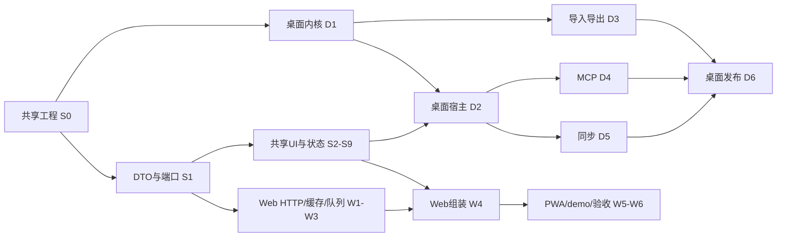

# 03 开发任务清单

> **开发唯一入口。** 先读00的产品范围、02概要设计、04工程规范，再读所属详细设计完整任务。本文只记录任务顺序、状态与文件责任；验收标准只有详细设计一份，不在这里复制。
> 当前：已有Web/桌面骨架与本地验证记录；以下全阶段功能任务均为待实施。设计文件写完不等于功能已完成。本轮不自动提交、推送或部署。

## 1. 模型执行协议

1. 从第5节选择未完成且所有依赖已完成的任务；依赖以所属详细设计的 `依赖` 字段为唯一来源。编号排序不是执行顺序。
2. 完整阅读该任务的契约、改动文件、步骤、不做事项、判据、陷阱；核对当前代码，不从旧稿推断接口。
3. 领取文件所有权。不得同时让两个模型修改同一文件；同一模块的多个任务默认串行。
4. 只完成该任务。若契约确有错误，先修02及相关详细设计，再一起迁移调用者，不补兼容shim绕过问题。
5. 按任务真实运行：纯函数/边界单测、真实HTTP或IPC、界面截图和键盘操作、打包/重启/恢复。未运行必须写“未验证”，不得用替身通过冒充真实功能。
6. 提交验收记录：任务号、变更文件、具体命令和退出结果、关键场景读回值、截图或artifact、未验证项、下一步依赖。全部判据通过后才把第5节该项改为 `[x]`。
7. 阻塞任务写明原因、已尝试方法和需要的输入；可继续不依赖它的其他任务，不重复空等。

### 1.1 单任务派发模板

```text
目标：执行 <任务号>，依据 docs/<详细设计文件> 中同名标题。
必读：docs/00-总览与决策.md、02-概要设计.md、04-工程规范.md；该任务所有依赖的交付记录。
拥有文件：<从改动范围复制具体文件，排除共享配置所有者正在修改的文件>。
禁止：改未领取文件；新增任务外功能；用假实现代替真实后端；未经授权推送/部署。
交付：完整实现、真实验收证据、必要文档更新、未验证项。不得仅返回“完成”。
```

## 2. Web 与桌面如何并行

**可以并行，但先固定共享合同。** S0/S1建立packages/app、DTO、Backend和工程检查后，Web宿主与Rust内核可以同时开发。共享UI独立推进，两端宿主最终接入同一套UI。



这是阶段关系图，不替代逐任务DAG。W4-2/W4-3必须先于W4-1；D6发布验收等D4/D5完成，不能因为已生成exe就先勾发布。

## 3. 文件所有权与集成规则

| 范围 | 默认所有者 | 可并行边界 |
| --- | --- | --- |
| `packages/shared/src/backend-types.ts`、`packages/app/src/backend/` | S1执行者 | S1-1/2完成后冻结；宿主不能各自改DTO |
| `packages/app/src/features/<feature>` | 各S任务执行者 | 不同feature可并行，AppRoot/路由注册集成时一次修改 |
| `web/src/client/` | W任务执行者 | HTTP与持久层共享文件先交付再开始outbox；同index.ts禁止竞争 |
| `desktop/src-tauri/core` | D1及后续声明的core扩展任务 | D4/D5只经public API；同迁移注册表由集成者分配连续版本 |
| `desktop/src/` | D2/3/4/5宿主执行者 | transport/types/组合根只一人编辑；功能分区可以并行 |
| 根package、lockfile、eslint、CI；Cargo workspace/lock/迁移表 | 当前集成负责人 | 子任务报依赖需求，集成人集中安装与更新；不得并发install/format |

迁移顺序按合并先后登记：D1核心v2已固定，D3导入标记、D4幂等、D5同步表不预占互相冲突的版本号。迁移合并后不可修改已发布版本。文件范围重叠时即使依赖图允许并行，也先串行或缩小写集。

## 4. 状态与门禁

- W0/D0是历史骨架里程碑，不是本清单的功能完成项。历史结果：shared/Web 36项单测、Web API e2e 174项以及桌面骨架verify通过；本轮只验证文档结构，不宣称新功能通过。
- 新阶段无占位完成：Svelte空页面、空Rust crate、mock-only演示、未提供权限的MCP工具都不能标完成。
- Web发布保持手动。桌面发布先有真实安装/退出/数据保留证据，再打tag。GitHub检查通过只说明该工作流覆盖的内容。
- 一旦某任务修改共用合同，相关消费者必须一并重验，不能只测一个更窄路径。
- 证据放任务提交说明或既有验收记录，不记录账号口令、token、正文或生产路径。

## 5. 全部任务索引

以下列表由详细设计的任务标题与依赖生成；判据请打开链接后的同编号标题。全部 `[ ]` 表示尚未执行，不是失败。

### 5.1 [详细设计-共享应用层](10-详细设计-共享应用层.md) — 33项

- [x] **S0-1 建包、版本与别名** — 2026-09-30：新增`packages/app`，固定Svelte 5.57.1、Vite 8.3.0、TypeScript/Vitest 5.9.3/4.1.10，并由Web与桌面共同导入`@app/foundation/AppBrand.svelte`。验证：app typecheck、两宿主svelte-check、两宿主production build、浏览器实测通过；Tauri真实窗口未验证，启动命令在当前执行环境中未输出启动日志且超时。判据：[10-详细设计-共享应用层.md](10-详细设计-共享应用层.md) 中同编号标题。
- [x] **S0-2 工程检查** — 2026-09-30：根ESLint与Prettier入口检查新app/Web/desktop代码的console、空catch、any、未处理Promise、循环依赖、硬编码色阶和跨宿主依赖；组件额外禁止直接fetch；新代码TS开启`noUncheckedIndexedAccess`、`exactOptionalPropertyTypes`、`noImplicitOverride`。验证：`pnpm run app:check`、web/desktop Svelte检查通过；临时console、Tauri import、`bg-blue-500`、悬空Promise和组件fetch样例均实际返回非零后删除。CI的web/desktop质量门均复用`app:check`。判据：[10-详细设计-共享应用层.md](10-详细设计-共享应用层.md) 中同编号标题。
- [x] **S0-3 测试运行配置** — 2026-09-30：`packages/app/vitest.config.ts` 建立共享Vitest 4.1.10的node/jsdom项目，Svelte由官方Vite插件编译，DOM项目接入`@testing-library/svelte/vite`自动清理。验证：临时runes组件经键盘激活更新DOM；临时node测试确认`window`未定义；两者通过后已删除临时证明用例，当前runner空测试以0退出。Web runner可解析`@app`。判据：[10-详细设计-共享应用层.md](10-详细设计-共享应用层.md) 中同编号标题。
- [x] **S1-1 跨端 DTO** — 2026-09-30：新增`packages/shared/src/backend-types.ts`，提供跨端请求/结果类型与Zod边界schema：错误码、BackendSession、文件夹/标签/设置patch、写入队列、进度与本地MCP状态。运行时拒绝负rev、缺失必填字段、错误null和非法时间；File/AbortSignal未进入DTO。验证：3个合法/非法报文单测通过；shared、Web、Desktop类型检查及Web生产构建通过。判据：[10-详细设计-共享应用层.md](10-详细设计-共享应用层.md) 中同编号标题。
- [x] **S1-2 端口、错误与事件** — 2026-09-30：实现`@app/backend`的完整Backend端口、可选云端/本地MCP端口、结构化BackendError和唯一ChangeFeed。订阅自解绑和dispose均幂等；错误仅保留server/deletionCursor/retryAfter/字段路径白名单，cancelled与offline分开。验证：事件多订阅、自解绑、销毁与安全错误字段3个测试通过；app/shared/Web/Desktop类型检查通过。判据：[10-详细设计-共享应用层.md](10-详细设计-共享应用层.md) 中同编号标题。
- [x] **S1-3 平台接缝** — 2026-09-30：实现`@app/platform`（Clock、PrefsStore、Notifier）、`@app/log`和`@app/root`的注入合同；HostExtensions只通过Svelte Component类型提供宿主界面。验证：独立PrefsStore互不共享、日志敏感字段拒绝/`[redacted]`通过，5个app测试及`app:check`通过。判据：[10-详细设计-共享应用层.md](10-详细设计-共享应用层.md) 中同编号标题。
- [ ] **S1-4 后端行为场景** — 依赖：S1-2、S0-3；判据：[10-详细设计-共享应用层.md](10-详细设计-共享应用层.md) 中同编号标题。
- [x] **S2-1 语言运行时** — 2026-09-30：实现runes `I18nState`、类型化双语词典、错误码映射、插值和日期/数字格式化；新增客户端错误翻译键与词典键/占位符一致性测试。验证：快速中文→英文切换的过期加载不会覆盖最终语言，插值缺参保留占位符；8个app测试和`app:check`通过。判据：[10-详细设计-共享应用层.md](10-详细设计-共享应用层.md) 中同编号标题。
- [x] **S2-2 主题与首屏** — 2026-09-30：共享token移入`packages/app/src/styles/tokens.css`，Web与Desktop引用同一份；实现主题控制器、system/reduced-motion监听清理和由Vite生成的Web首屏脚本。验证：11个app测试、app/shared/Web/Desktop类型检查、两宿主生产构建通过；浏览器首次加载确认dark/wisteria/white状态，7种accent的实际CSS变量均正确。Desktop首屏使用同一token样式；SvelteKit模板不支持该Web的Vite HTML转换，桌面真实WebView首屏截图仍待可启动Tauri进程后复验。判据：[10-详细设计-共享应用层.md](10-详细设计-共享应用层.md) 中同编号标题。
- [x] **S3-1 基础控件** — 2026-09-30：采用shadcn-svelte/bits-ui已安装的Button/Input/Select/Switch/Slider/Checkbox/ToggleGroup，并新增由ToggleGroup组合的Segmented；DOM测试覆盖禁用按钮、checkbox空格键、switch、分段选择和屏幕阅读器可见名称。验证：`pnpm run app:check && pnpm --filter @autonote/app test`通过，8测试文件13项通过。判据：[10-详细设计-共享应用层.md](10-详细设计-共享应用层.md) 中同编号标题。
- [x] **S3-2 覆盖层与反馈** — 2026-09-30：通过shadcn-svelte CLI加入Dialog/Drawer/DropdownMenu/Tooltip/Sonner源组件及运行依赖，新增共享OverlayNotifier、ConfirmationHost和OverlayProvider；确认队列逐项处理，反馈经svelte-sonner。DOM测试覆盖嵌套Esc只关闭顶层、确认串行和最终body滚动锁释放。验证：`pnpm --filter @autonote/app test && pnpm run app:check`通过，9测试文件15项通过。判据：[10-详细设计-共享应用层.md](10-详细设计-共享应用层.md) 中同编号标题。
- [x] **S3-3 开发图库** — 2026-09-30：新增共享Gallery，展示控件、校验、禁用、长标签、通知、Dialog与Drawer的独立状态；Web仅在dev模式的`/__gallery`动态挂载，Desktop同路径由dev路由守卫，生产不可访问。验证：Gallery DOM测试、浏览器实际`/__gallery`打开/关闭Dialog、app/web质量门和生产构建通过；生产client确认无gallery chunk。Desktop真实Tauri窗口仍受当前环境启动问题限制，未验证截图。判据：[10-详细设计-共享应用层.md](10-详细设计-共享应用层.md) 中同编号标题。
- [x] **S4-1 Markdown 基础渲染** — 2026-09-30：新增共享markdown-it/DOMPurify渲染器与prose样式，支持front matter、GFM任务、脚注/mark、WikiLink/嵌入占位、行内标签、callout、折叠、tabs、md-example、数学/mermaid占位、代码围栏信息和源行映射；HTML经DOMPurify移除脚本、事件属性与危险URL。验证：Renderer DOM夹具覆盖扩展与恶意HTML，app 11文件20项测试、web质量门和desktop检查通过。判据：[10-详细设计-共享应用层.md](10-详细设计-共享应用层.md) 中同编号标题。
- [x] **S4-2 增强、嵌入与懒加载** — 2026-09-30：新增按需Prism/KaTeX/Mermaid增强、PreviewEnhancer generation/AbortSignal保护和RenderServices注入的有界嵌入解析；循环嵌入显示错误且深度/总数受限，图表或可选加载失败保留已净化的源码。验证：math回退、循环嵌入、旧预览取消与block math夹具通过；app 12文件24项测试、app/web质量门、desktop检查通过。判据：[10-详细设计-共享应用层.md](10-详细设计-共享应用层.md) 中同编号标题。
- [x] **S5-1 编辑器生命周期** — 2026-09-30：新增共享Svelte CodeMirror 6编辑器，单次创建EditorView，以Compartment重配行号、tab与placeholder；外部文档回声用Annotation抑制onChange，销毁回调释放view，多窗格各持独立实例与history。验证：双pane编辑/undo隔离、写回声只计一次的DOM测试通过；app 13文件26项、web质量门及desktop检查通过。判据：[10-详细设计-共享应用层.md](10-详细设计-共享应用层.md) 中同编号标题。
- [ ] **S5-2 补全与附件粘贴** — 依赖：S5-1；判据：[10-详细设计-共享应用层.md](10-详细设计-共享应用层.md) 中同编号标题。
- [ ] **S6-1 同步合并算法** — 依赖：S1-2、S0-3；判据：[10-详细设计-共享应用层.md](10-详细设计-共享应用层.md) 中同编号标题。
- [ ] **S6-2 笔记编辑与保存状态** — 依赖：S6-1、S1-3；判据：[10-详细设计-共享应用层.md](10-详细设计-共享应用层.md) 中同编号标题。
- [ ] **S6-3 组织操作和回滚** — 依赖：S6-2；判据：[10-详细设计-共享应用层.md](10-详细设计-共享应用层.md) 中同编号标题。
- [ ] **S6-4 会话与设置状态** — 依赖：S1-2、S2-1；判据：[10-详细设计-共享应用层.md](10-详细设计-共享应用层.md) 中同编号标题。
- [ ] **S6-5 布局和交互状态** — 依赖：S1-3、S2-2；判据：[10-详细设计-共享应用层.md](10-详细设计-共享应用层.md) 中同编号标题。
- [ ] **S7-1 应用组合根** — 依赖：S6-2、S6-3、S6-4、S6-5、S3-2；判据：[10-详细设计-共享应用层.md](10-详细设计-共享应用层.md) 中同编号标题。
- [ ] **S7-2 侧栏与树** — 依赖：S7-1；判据：[10-详细设计-共享应用层.md](10-详细设计-共享应用层.md) 中同编号标题。
- [ ] **S7-3 列表与批量操作** — 依赖：S7-1；判据：[10-详细设计-共享应用层.md](10-详细设计-共享应用层.md) 中同编号标题。
- [ ] **S7-4 命令与快捷键** — 依赖：S7-1；判据：[10-详细设计-共享应用层.md](10-详细设计-共享应用层.md) 中同编号标题。
- [ ] **S7-5 登录与TOTP** — 依赖：S6-4、S3-2；判据：[10-详细设计-共享应用层.md](10-详细设计-共享应用层.md) 中同编号标题。
- [ ] **S8-1 工作区双窗格** — 依赖：S7-1、S5-2；判据：[10-详细设计-共享应用层.md](10-详细设计-共享应用层.md) 中同编号标题。
- [ ] **S8-2 预览交互** — 依赖：S8-1、S4-2；判据：[10-详细设计-共享应用层.md](10-详细设计-共享应用层.md) 中同编号标题。
- [ ] **S8-3 反链与版本** — 依赖：S8-2；判据：[10-详细设计-共享应用层.md](10-详细设计-共享应用层.md) 中同编号标题。
- [ ] **S9-1 设置框架与资源生命周期** — 依赖：S7-1；判据：[10-详细设计-共享应用层.md](10-详细设计-共享应用层.md) 中同编号标题。
- [ ] **S9-2 通用设置与数据管理** — 依赖：S9-1、S2-1、S2-2；判据：[10-详细设计-共享应用层.md](10-详细设计-共享应用层.md) 中同编号标题。
- [ ] **S9-3 云端设置与分享** — 依赖：S9-1、S7-5；判据：[10-详细设计-共享应用层.md](10-详细设计-共享应用层.md) 中同编号标题。
- [ ] **S9-4 关系图谱** — 依赖：S7-1、S3-2；判据：[10-详细设计-共享应用层.md](10-详细设计-共享应用层.md) 中同编号标题。
- [x] **W1-1 Web平台边界与工程接缝** — 2026-09-30：新增runtime、Timers、PageSignals、WebPrefsStore和固定200条的ConsoleRingLogger；非边界Web代码被ESLint禁止直接fetch/indexedDB/BroadcastChannel/WebSocket/localStorage/navigator，组件骨架的直接网络请求已移除。验证：Web平台jsdom 4项测试、lint、Svelte检查、生产构建及浏览器刷新后localStorage布局值保留均通过；阻止浏览器localStorage的真实用户权限场景未验证。判据：[11-详细设计-Web宿主.md](11-详细设计-Web宿主.md) 中同编号标题。
- [x] **W1-2 Svelte与共享包i18n检查** — 2026-09-30：新增TypeScript AST与Svelte compiler AST检查器，验证中英文语言键和插值一致、静态`/t`调用键存在、Svelte可见文本和aria/placeholder/title不绕过翻译；加入3项Node行为测试并纳入web:check/web:test。验证：`pnpm run web:check && pnpm run web:test`通过，包含shared 11项、Web 32项与检查器3项测试。判据：[11-详细设计-Web宿主.md](11-详细设计-Web宿主.md) 中同编号标题。
- [x] **W1-3 注释扫描与检查入口收敛** — 2026-09-30：新增基于TypeScript scanner、Svelte compiler及CSS/HTML/TOML解析的精确注释检查器；allowlist按路径、偏移、种类和内容hash逐条固定，模板/script/style未批准注释均失败，URL和字符串内`//`不误判。验证：`pnpm run web:check && pnpm run web:test`通过，含检查器3项行为测试。判据：[11-详细设计-Web宿主.md](11-详细设计-Web宿主.md) 中同编号标题。
### 5.2 [详细设计-Web宿主](11-详细设计-Web宿主.md) — 18项

- [ ] **W1-1 Web平台边界与工程接缝** — 依赖：S0-1、S0-2、S0-3、S1-1、S1-2、S1-3；判据：[11-详细设计-Web宿主.md](11-详细设计-Web宿主.md) 中同编号标题。
- [ ] **W1-2 Svelte与共享包i18n检查** — 依赖：W1-1、S2-1；判据：[11-详细设计-Web宿主.md](11-详细设计-Web宿主.md) 中同编号标题。
- [ ] **W1-3 注释扫描与检查入口收敛** — 依赖：W1-1；判据：[11-详细设计-Web宿主.md](11-详细设计-Web宿主.md) 中同编号标题。
- [ ] **W2-1 HTTP传输、错误与用户本地存储** — 依赖：W1-1、S1-4；判据：[11-详细设计-Web宿主.md](11-详细设计-Web宿主.md) 中同编号标题。
- [ ] **W2-2 会话、账号、设置与注销闸门** — 依赖：W2-1、S6-4；判据：[11-详细设计-Web宿主.md](11-详细设计-Web宿主.md) 中同编号标题。
- [ ] **W2-3 组织、查询、附件分页端口** — 依赖：W2-1、S6-3、S9-4；判据：[11-详细设计-Web宿主.md](11-详细设计-Web宿主.md) 中同编号标题。
- [ ] **W3-1 文本持久队列与缓存覆盖** — 依赖：W2-1、S6-1、S6-2；判据：[11-详细设计-Web宿主.md](11-详细设计-Web宿主.md) 中同编号标题。
- [ ] **W3-2 互斥回放、冲突历史与恢复副本** — 依赖：W3-1；判据：[11-详细设计-Web宿主.md](11-详细设计-Web宿主.md) 中同编号标题。
- [ ] **W3-3 完整笔记端口、破坏操作与保存联验** — 依赖：W3-2、W2-2、W2-3、S8-3；判据：[11-详细设计-Web宿主.md](11-详细设计-Web宿主.md) 中同编号标题。
- [ ] **W4-1 组合根、路由与全部共享界面挂载** — 依赖：W3-3、W4-2、W4-3、S7-1、S7-2、S7-3、S7-4、S7-5、S8-1、S8-2、S8-3、S9-1、S9-2、S9-3、S9-4；判据：[11-详细设计-Web宿主.md](11-详细设计-Web宿主.md) 中同编号标题。
- [ ] **W4-2 分页同步、跨页选主和实时回退** — 依赖：W3-3、S6-1；判据：[11-详细设计-Web宿主.md](11-详细设计-Web宿主.md) 中同编号标题。
- [ ] **W4-3 导入导出、分享管理与全部云端设置** — 依赖：W2-3、W3-3、S9-2、S9-3；判据：[11-详细设计-Web宿主.md](11-详细设计-Web宿主.md) 中同编号标题。
- [ ] **W5-1 匿名分享页与公开Markdown行为** — 依赖：W4-1、W4-3、S4-1、S4-2、S3-1、S3-2；判据：[11-详细设计-Web宿主.md](11-详细设计-Web宿主.md) 中同编号标题。
- [ ] **W5-2 PWA离线资源与安全更新** — 依赖：W4-2、W5-1、S2-2、S9-1；判据：[11-详细设计-Web宿主.md](11-详细设计-Web宿主.md) 中同编号标题。
- [ ] **W5-3 Demo完整注入与静态发布** — 依赖：W4-3、W5-1、W5-2；判据：[11-详细设计-Web宿主.md](11-详细设计-Web宿主.md) 中同编号标题。
- [ ] **W6-1 多配置构建与部署定位** — 依赖：W1-2、W1-3、W5-3；判据：[11-详细设计-Web宿主.md](11-详细设计-Web宿主.md) 中同编号标题。
- [ ] **W6-2 升级与全功能真实验收** — 依赖：W6-1、W4-2、W4-3、W5-1、W5-2、W5-3、S1-4；判据：[11-详细设计-Web宿主.md](11-详细设计-Web宿主.md) 中同编号标题。
- [ ] **W6-3 诊断导出与宿主生命周期收口** — 依赖：W6-2、W1-1、S9-1；判据：[11-详细设计-Web宿主.md](11-详细设计-Web宿主.md) 中同编号标题。

### 5.3 [详细设计-桌面内核](20-详细设计-桌面内核.md) — 8项

- [ ] **D1-1 类型与错误** — 依赖：S0-1、S0-2；判据：[20-详细设计-桌面内核.md](20-详细设计-桌面内核.md) 中同编号标题。
- [ ] **D1-2 Schema 与迁移** — 依赖：D1-1；判据：[20-详细设计-桌面内核.md](20-详细设计-桌面内核.md) 中同编号标题。
- [ ] **D1-3 纯函数** — 依赖：D1-1；判据：[20-详细设计-桌面内核.md](20-详细设计-桌面内核.md) 中同编号标题。
- [ ] **D1-4 笔记写入** — 依赖：D1-2、D1-3；判据：[20-详细设计-桌面内核.md](20-详细设计-桌面内核.md) 中同编号标题。
- [ ] **D1-5 文件夹与标签** — 依赖：D1-2、D1-4；判据：[20-详细设计-桌面内核.md](20-详细设计-桌面内核.md) 中同编号标题。
- [ ] **D1-6 查询** — 依赖：D1-2、D1-3、D1-4；判据：[20-详细设计-桌面内核.md](20-详细设计-桌面内核.md) 中同编号标题。
- [ ] **D1-7 附件** — 依赖：D1-1、D1-2、D1-4；判据：[20-详细设计-桌面内核.md](20-详细设计-桌面内核.md) 中同编号标题。
- [ ] **D1-8 IPC 事件** — 依赖：D1-4、D1-5、D1-6、D1-7；判据：[20-详细设计-桌面内核.md](20-详细设计-桌面内核.md) 中同编号标题。

### 5.4 [详细设计-桌面宿主](21-详细设计-桌面宿主.md) — 16项

- [ ] **D2-1 IPC transport** — 依赖：S0-1、S1-1、S1-2、S1-3、D1-8；判据：[21-详细设计-桌面宿主.md](21-详细设计-桌面宿主.md) 中同编号标题。
- [ ] **D2-2 挂载共享应用** — 依赖：D2-1、S7-1、S7-2、S7-3、S8-2；判据：[21-详细设计-桌面宿主.md](21-详细设计-桌面宿主.md) 中同编号标题。
- [ ] **D2-3 事件与状态接入** — 依赖：D2-1、D2-2、D1-8、S6-1；判据：[21-详细设计-桌面宿主.md](21-详细设计-桌面宿主.md) 中同编号标题。
- [ ] **D2-4 附件 URL 适配** — 依赖：D2-1、D1-7、S4-2、S5-2；判据：[21-详细设计-桌面宿主.md](21-详细设计-桌面宿主.md) 中同编号标题。
- [ ] **D2-5 宿主设置与路径** — 依赖：D2-2、S9-1、D1-2；判据：[21-详细设计-桌面宿主.md](21-详细设计-桌面宿主.md) 中同编号标题。
- [ ] **D2-6 日志** — 依赖：D2-1、S1-3；判据：[21-详细设计-桌面宿主.md](21-详细设计-桌面宿主.md) 中同编号标题。
- [ ] **D3-1 快照导出** — 依赖：D1-4、D1-5、D1-7、S1-1；判据：[21-详细设计-桌面宿主.md](21-详细设计-桌面宿主.md) 中同编号标题。
- [ ] **D3-2 验证与恢复** — 依赖：D3-1、D1-4、D1-5、D1-7、D1-8；判据：[21-详细设计-桌面宿主.md](21-详细设计-桌面宿主.md) 中同编号标题。
- [ ] **D3-3 Obsidian 导入** — 依赖：D3-2、D1-3；判据：[21-详细设计-桌面宿主.md](21-详细设计-桌面宿主.md) 中同编号标题。
- [ ] **D3-4 操作 UI 与调用生命周期** — 依赖：D3-1、D3-2、D3-3、D2-1、D2-2、S9-2；判据：[21-详细设计-桌面宿主.md](21-详细设计-桌面宿主.md) 中同编号标题。
- [ ] **D6-1 单实例与托盘** — 依赖：D2-2、D2-5；判据：[21-详细设计-桌面宿主.md](21-详细设计-桌面宿主.md) 中同编号标题。
- [ ] **D6-2 全局快捷键** — 依赖：D6-1、D2-5；判据：[21-详细设计-桌面宿主.md](21-详细设计-桌面宿主.md) 中同编号标题。
- [ ] **D6-3 窗口状态与退出** — 依赖：D6-1、D6-2、D3-4、D2-6、S6-2；判据：[21-详细设计-桌面宿主.md](21-详细设计-桌面宿主.md) 中同编号标题。
- [ ] **D6-4 构建打包与安全清理** — 依赖：D6-3、D3-4；判据：[21-详细设计-桌面宿主.md](21-详细设计-桌面宿主.md) 中同编号标题。
- [ ] **D6-5 真实发布包验证** — 依赖：D6-4、D4-5、D5-7；判据：[21-详细设计-桌面宿主.md](21-详细设计-桌面宿主.md) 中同编号标题。
- [ ] **D6-6 工作流** — 依赖：D6-5；判据：[21-详细设计-桌面宿主.md](21-详细设计-桌面宿主.md) 中同编号标题。

### 5.5 [详细设计-桌面同步与MCP](22-详细设计-桌面同步与MCP.md) — 12项

- [ ] **D4-1 MCP SDK 与协议装配** — 依赖：D1-2、D2-1；判据：[22-详细设计-桌面同步与MCP.md](22-详细设计-桌面同步与MCP.md) 中同编号标题。
- [ ] **D4-2 鉴权、权限和设置守卫** — 依赖：D4-1、D2-5、D2-6；判据：[22-详细设计-桌面同步与MCP.md](22-详细设计-桌面同步与MCP.md) 中同编号标题。
- [ ] **D4-3 只读工具** — 依赖：D4-1、D4-2、D1-3、D1-6、D1-7；判据：[22-详细设计-桌面同步与MCP.md](22-详细设计-桌面同步与MCP.md) 中同编号标题。
- [ ] **D4-4 写工具、危险操作与单事务幂等** — 依赖：D4-2、D4-3、D1-4、D1-5、D1-7；判据：[22-详细设计-桌面同步与MCP.md](22-详细设计-桌面同步与MCP.md) 中同编号标题。
- [ ] **D4-5 MCP 设置、生命周期与真实客户端验收** — 依赖：D4-1、D4-2、D4-4、D2-5；判据：[22-详细设计-桌面同步与MCP.md](22-详细设计-桌面同步与MCP.md) 中同编号标题。
- [ ] **D5-1 存储会话、迁移与 DPAPI** — 依赖：D1-2、D2-6；判据：[22-详细设计-桌面同步与MCP.md](22-详细设计-桌面同步与MCP.md) 中同编号标题。
- [ ] **D5-2 RemoteApi、HTTP 会话与服务端兼容性** — 依赖：D5-1、D1-2；判据：[22-详细设计-桌面同步与MCP.md](22-详细设计-桌面同步与MCP.md) 中同编号标题。
- [ ] **D5-3 首次绑定、预览、确认和 epoch 隔离** — 依赖：D5-1、D5-2、D1-4、D1-5、D1-7；判据：[22-详细设计-桌面同步与MCP.md](22-详细设计-桌面同步与MCP.md) 中同编号标题。
- [ ] **D5-4 pull、游标和本地合并** — 依赖：D5-2、D5-3、D1-3、D1-4、D1-5、D1-6；判据：[22-详细设计-桌面同步与MCP.md](22-详细设计-桌面同步与MCP.md) 中同编号标题。
- [ ] **D5-5 push、outbox、冲突和 metadata 风险** — 依赖：D5-2、D5-3、D5-4、D1-4、D1-5、D1-7；判据：[22-详细设计-桌面同步与MCP.md](22-详细设计-桌面同步与MCP.md) 中同编号标题。
- [ ] **D5-6 附件同步和传输副本** — 依赖：D5-4、D5-5、D1-7；判据：[22-详细设计-桌面同步与MCP.md](22-详细设计-桌面同步与MCP.md) 中同编号标题。
- [ ] **D5-7 实时状态、串行 engine 和真实同步验收** — 依赖：D5-4、D5-5、D5-6、D2-3、D2-6；判据：[22-详细设计-桌面同步与MCP.md](22-详细设计-桌面同步与MCP.md) 中同编号标题。

## 6. 依赖拓扑与并行执行批次

同批表示依赖层面可并行，不等于文件写集无冲突；必须同时遵守第3节。批次之间不强制全体等待，单项依赖完成即可领取。

| 批次 | 可领取任务 |
| --- | --- |
| 1 | S0-1 |
| 2 | S0-2、S0-3、S1-1 |
| 3 | D1-1、S1-2 |
| 4 | D1-2、D1-3、S1-3、S1-4、S6-1 |
| 5 | D1-4、S2-1、S2-2、S6-2、W1-1 |
| 6 | D1-5、D1-6、D1-7、S3-1、S4-1、S6-3、S6-4、S6-5、W1-2、W1-3、W2-1 |
| 7 | D1-8、D3-1、S3-2、S4-2、W2-2、W3-1 |
| 8 | D2-1、D3-2、S3-3、S5-1、S7-1、S7-5、W3-2 |
| 9 | D2-6、D3-3、D4-1、S5-2、S7-2、S7-3、S7-4、S9-1、S9-4 |
| 10 | D2-4、D5-1、S8-1、S9-2、S9-3、W2-3 |
| 11 | D5-2、S8-2 |
| 12 | D2-2、D5-3、S8-3 |
| 13 | D2-3、D2-5、D3-4、D5-4、W3-3 |
| 14 | D4-2、D5-5、D6-1、W4-2、W4-3 |
| 15 | D4-3、D5-6、D6-2、W4-1 |
| 16 | D4-4、D5-7、D6-3、W5-1 |
| 17 | D4-5、D6-4、W5-2 |
| 18 | D6-5、W5-3 |
| 19 | D6-6、W6-1 |
| 20 | W6-2 |
| 21 | W6-3 |

## 7. 本轮设计检查记录

- 共87个唯一任务：共享33、Web18、桌面内核8、桌面宿主16、同步/MCP12。所有任务均有依赖、范围、不做、步骤、判据、陷阱。
- 已程序检查任务号引用和依赖DAG：不存在未定义依赖或循环；本表按详细设计的真实依赖生成。
- 已在临时SQLite内执行20/22文档中的DDL，核心与MCP/同步表可顺序创建；这只证明设计SQL可执行，不代替未来Rust迁移/行为测试。
- 旧三份粗稿的功能矩阵、历史验证、品牌/部署说明已分别收敛到00/01/10/11/20/21/22，删除重复粗稿，不保留第二套任务清单。
- 本轮没有运行新功能或安装依赖；SDK、插件、CI发布和真实窗口的实施验收仍全部待执行。
