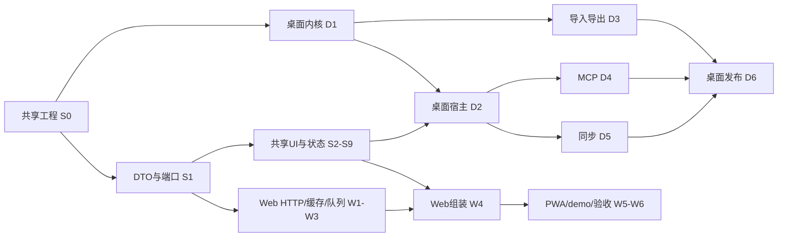

# 03 开发任务清单

> **开发唯一入口。** 先读00的产品范围、02概要设计、04工程规范，再读所属详细设计完整任务。本文只记录任务顺序、状态与文件责任；验收标准只有详细设计一份，不在这里复制。
> 当前：Web/桌面骨架及部分共享、Web、桌面内核任务已经实际实现并按各任务行记录验证；未勾选的全阶段任务仍待实施或真实联验。本轮不自动提交、推送或部署。

## 1. 模型执行协议

1. 从第5节选择未完成且所有依赖已完成的任务；依赖以所属详细设计的 `依赖` 字段为唯一来源。编号排序不是执行顺序。
2. 完整阅读该任务的契约、改动文件、步骤、不做事项、判据、陷阱；核对当前代码，不从旧稿推断接口。
3. 领取文件所有权。不得同时让两个模型修改同一文件；同一模块的多个任务默认串行。
4. 只完成该任务。若契约确有错误，先修02及相关详细设计，再一起迁移调用者，不补兼容shim绕过问题。
5. 按任务真实运行：纯函数/边界单测、真实HTTP或IPC、界面截图和键盘操作、打包/重启/恢复。未运行必须写“未验证”，不得用替身通过冒充真实功能。
6. 提交验收记录：任务号、变更文件、具体命令和退出结果、关键场景读回值、截图或artifact、未验证项、下一步依赖。全部判据通过后才把第5节该项改为 `[x]`。
7. 阻塞任务写明原因、已尝试方法和需要的输入；可继续不依赖它的其他任务，不重复空等。

### 1.1 单任务派发模板

```text
目标：执行 <任务号>，依据 docs/<详细设计文件> 中同名标题。
必读：docs/00-总览与决策.md、02-概要设计.md、04-工程规范.md；该任务所有依赖的交付记录。
拥有文件：<从改动范围复制具体文件，排除共享配置所有者正在修改的文件>。
禁止：改未领取文件；新增任务外功能；用假实现代替真实后端；未经授权推送/部署。
交付：完整实现、真实验收证据、必要文档更新、未验证项。不得仅返回“完成”。
```

## 2. Web 与桌面如何并行

**可以并行，但先固定共享合同。** S0/S1建立packages/app、DTO、Backend和工程检查后，Web宿主与Rust内核可以同时开发。共享UI独立推进，两端宿主最终接入同一套UI。



这是阶段关系图，不替代逐任务DAG。W4-2/W4-3必须先于W4-1；D6发布验收等D4/D5完成，不能因为已生成exe就先勾发布。

## 3. 文件所有权与集成规则

| 范围                                                                | 默认所有者                 | 可并行边界                                                     |
| ------------------------------------------------------------------- | -------------------------- | -------------------------------------------------------------- |
| `packages/shared/src/backend-types.ts`、`packages/app/src/backend/` | S1执行者                   | S1-1/2完成后冻结；宿主不能各自改DTO                            |
| `packages/app/src/features/<feature>`                               | 各S任务执行者              | 不同feature可并行，AppRoot/路由注册集成时一次修改              |
| `web/src/client/`                                                   | W任务执行者                | HTTP与持久层共享文件先交付再开始outbox；同index.ts禁止竞争     |
| `desktop/src-tauri/core`                                            | D1及后续声明的core扩展任务 | D4/D5只经public API；同迁移注册表由集成者分配连续版本          |
| `desktop/src/`                                                      | D2/3/4/5宿主执行者         | transport/types/组合根只一人编辑；功能分区可以并行             |
| 根package、lockfile、eslint、CI；Cargo workspace/lock/迁移表        | 当前集成负责人             | 子任务报依赖需求，集成人集中安装与更新；不得并发install/format |

迁移顺序按合并先后登记：D1核心v2已固定，D3导入标记、D4幂等、D5同步表不预占互相冲突的版本号。迁移合并后不可修改已发布版本。文件范围重叠时即使依赖图允许并行，也先串行或缩小写集。

## 4. 状态与门禁

- W0/D0是历史骨架里程碑，不是本清单的功能完成项。历史结果：shared/Web 36项单测、Web API e2e 174项以及桌面骨架verify通过；本轮只验证文档结构，不宣称新功能通过。
- 新阶段无占位完成：Svelte空页面、空Rust crate、mock-only演示、未提供权限的MCP工具都不能标完成。
- Web发布保持手动。桌面发布先有真实安装/退出/数据保留证据，再打tag。GitHub检查通过只说明该工作流覆盖的内容。
- 一旦某任务修改共用合同，相关消费者必须一并重验，不能只测一个更窄路径。
- 证据放任务提交说明或既有验收记录，不记录账号口令、token、正文或生产路径。

## 5. 全部任务索引

以下列表由详细设计的任务标题与依赖生成；判据请打开链接后的同编号标题。全部 `[ ]` 表示尚未执行，不是失败。

### 5.1 [详细设计-共享应用层](10-详细设计-共享应用层.md) — 33项

- [x] **S0-1 建包、版本与别名** — 2026-09-30：新增`packages/app`，固定Svelte 5.57.1、Vite 8.3.0、TypeScript/Vitest 5.9.3/4.1.10，并由Web与桌面共同导入`@app/foundation/AppBrand.svelte`。验证：app typecheck、两宿主svelte-check、两宿主production build、浏览器实测通过；Tauri真实窗口未验证，启动命令在当前执行环境中未输出启动日志且超时。判据：[10-详细设计-共享应用层.md](10-详细设计-共享应用层.md) 中同编号标题。
- [x] **S0-2 工程检查** — 2026-09-30：根ESLint与Prettier入口检查新app/Web/desktop代码的console、空catch、any、未处理Promise、循环依赖、硬编码色阶和跨宿主依赖；组件额外禁止直接fetch；新代码TS开启`noUncheckedIndexedAccess`、`exactOptionalPropertyTypes`、`noImplicitOverride`。验证：`pnpm run app:check`、web/desktop Svelte检查通过；临时console、Tauri import、`bg-blue-500`、悬空Promise和组件fetch样例均实际返回非零后删除。CI的web/desktop质量门均复用`app:check`。判据：[10-详细设计-共享应用层.md](10-详细设计-共享应用层.md) 中同编号标题。
- [x] **S0-3 测试运行配置** — 2026-09-30：`packages/app/vitest.config.ts` 建立共享Vitest 4.1.10的node/jsdom项目，Svelte由官方Vite插件编译，DOM项目接入`@testing-library/svelte/vite`自动清理。验证：临时runes组件经键盘激活更新DOM；临时node测试确认`window`未定义；两者通过后已删除临时证明用例，当前runner空测试以0退出。Web runner可解析`@app`。判据：[10-详细设计-共享应用层.md](10-详细设计-共享应用层.md) 中同编号标题。
- [x] **S1-1 跨端 DTO** — 2026-09-30：新增`packages/shared/src/backend-types.ts`，提供跨端请求/结果类型与Zod边界schema：错误码、BackendSession、文件夹/标签/设置patch、写入队列、进度与本地MCP状态。运行时拒绝负rev、缺失必填字段、错误null和非法时间；File/AbortSignal未进入DTO。验证：3个合法/非法报文单测通过；shared、Web、Desktop类型检查及Web生产构建通过。判据：[10-详细设计-共享应用层.md](10-详细设计-共享应用层.md) 中同编号标题。
- [x] **S1-2 端口、错误与事件** — 2026-09-30：实现`@app/backend`的完整Backend端口、可选云端/本地MCP端口、结构化BackendError和唯一ChangeFeed。订阅自解绑和dispose均幂等；错误仅保留server/deletionCursor/retryAfter/字段路径白名单，cancelled与offline分开。验证：事件多订阅、自解绑、销毁与安全错误字段3个测试通过；app/shared/Web/Desktop类型检查通过。判据：[10-详细设计-共享应用层.md](10-详细设计-共享应用层.md) 中同编号标题。
- [x] **S1-3 平台接缝** — 2026-09-30：实现`@app/platform`（Clock、PrefsStore、Notifier）、`@app/log`和`@app/root`的注入合同；HostExtensions只通过Svelte Component类型提供宿主界面。验证：独立PrefsStore互不共享、日志敏感字段拒绝/`[redacted]`通过，5个app测试及`app:check`通过。判据：[10-详细设计-共享应用层.md](10-详细设计-共享应用层.md) 中同编号标题。
- [ ] **S1-4 后端行为场景** — 依赖：S1-2、S0-3；判据：[10-详细设计-共享应用层.md](10-详细设计-共享应用层.md) 中同编号标题。
- [x] **S2-1 语言运行时** — 2026-09-30：实现runes `I18nState`、类型化双语词典、错误码映射、插值和日期/数字格式化；新增客户端错误翻译键与词典键/占位符一致性测试。验证：快速中文→英文切换的过期加载不会覆盖最终语言，插值缺参保留占位符；8个app测试和`app:check`通过。判据：[10-详细设计-共享应用层.md](10-详细设计-共享应用层.md) 中同编号标题。
- [x] **S2-2 主题与首屏** — 2026-09-30：共享token移入`packages/app/src/styles/tokens.css`，Web与Desktop引用同一份；实现主题控制器、system/reduced-motion监听清理和由Vite生成的Web首屏脚本。验证：11个app测试、app/shared/Web/Desktop类型检查、两宿主生产构建通过；浏览器首次加载确认dark/wisteria/white状态，7种accent的实际CSS变量均正确。Desktop首屏使用同一token样式；SvelteKit模板不支持该Web的Vite HTML转换，桌面真实WebView首屏截图仍待可启动Tauri进程后复验。判据：[10-详细设计-共享应用层.md](10-详细设计-共享应用层.md) 中同编号标题。
- [x] **S3-1 基础控件** — 2026-09-30：采用shadcn-svelte/bits-ui已安装的Button/Input/Select/Switch/Slider/Checkbox/ToggleGroup，并新增由ToggleGroup组合的Segmented；DOM测试覆盖禁用按钮、checkbox空格键、switch、分段选择和屏幕阅读器可见名称。验证：`pnpm run app:check && pnpm --filter @autonote/app test`通过，8测试文件13项通过。判据：[10-详细设计-共享应用层.md](10-详细设计-共享应用层.md) 中同编号标题。
- [x] **S3-2 覆盖层与反馈** — 2026-09-30：通过shadcn-svelte CLI加入Dialog/Drawer/DropdownMenu/Tooltip/Sonner源组件及运行依赖，新增共享OverlayNotifier、ConfirmationHost和OverlayProvider；确认队列逐项处理，反馈经svelte-sonner。DOM测试覆盖嵌套Esc只关闭顶层、确认串行和最终body滚动锁释放。验证：`pnpm --filter @autonote/app test && pnpm run app:check`通过，9测试文件15项通过。判据：[10-详细设计-共享应用层.md](10-详细设计-共享应用层.md) 中同编号标题。
- [x] **S3-3 开发图库** — 2026-09-30：新增共享Gallery，展示控件、校验、禁用、长标签、通知、Dialog与Drawer的独立状态；Web仅在dev模式的`/__gallery`动态挂载，Desktop同路径由dev路由守卫，生产不可访问。验证：Gallery DOM测试、浏览器实际`/__gallery`打开/关闭Dialog、app/web质量门和生产构建通过；生产client确认无gallery chunk。Desktop真实Tauri窗口仍受当前环境启动问题限制，未验证截图。判据：[10-详细设计-共享应用层.md](10-详细设计-共享应用层.md) 中同编号标题。
- [x] **S4-1 Markdown 基础渲染** — 2026-09-30：新增共享markdown-it/DOMPurify渲染器与prose样式，支持front matter、GFM任务、脚注/mark、WikiLink/嵌入占位、行内标签、callout、折叠、tabs、md-example、数学/mermaid占位、代码围栏信息和源行映射；HTML经DOMPurify移除脚本、事件属性与危险URL。验证：Renderer DOM夹具覆盖扩展与恶意HTML，app 11文件20项测试、web质量门和desktop检查通过。判据：[10-详细设计-共享应用层.md](10-详细设计-共享应用层.md) 中同编号标题。
- [x] **S4-2 增强、嵌入与懒加载** — 2026-09-30：新增按需Prism/KaTeX/Mermaid增强、PreviewEnhancer generation/AbortSignal保护和RenderServices注入的有界嵌入解析；循环嵌入显示错误且深度/总数受限，图表或可选加载失败保留已净化的源码。验证：math回退、循环嵌入、旧预览取消与block math夹具通过；app 12文件24项测试、app/web质量门、desktop检查通过。判据：[10-详细设计-共享应用层.md](10-详细设计-共享应用层.md) 中同编号标题。
- [x] **S5-1 编辑器生命周期** — 2026-09-30：新增共享Svelte CodeMirror 6编辑器，单次创建EditorView，以Compartment重配行号、tab与placeholder；外部文档回声用Annotation抑制onChange，销毁回调释放view，多窗格各持独立实例与history。验证：双pane编辑/undo隔离、写回声只计一次的DOM测试通过；app 13文件26项、web质量门及desktop检查通过。判据：[10-详细设计-共享应用层.md](10-详细设计-共享应用层.md) 中同编号标题。
- [x] **S5-2 补全与附件粘贴** — 2026-10-03：CodeMirror 接入 WikiLink/标签/围栏补全与键盘选择、安全 HTML 粘贴、附件经注入上传；切笔记后的结果仅回写原笔记，失败/取消保留输入。验证：编辑器 4 文件 25 项测试通过；真实浏览器附件上传须待宿主 files 端口接入后联验。
- [x] **S6-1 同步合并算法** — 2026-10-03：实现 rev/元数据合并、dirty 正文保护、cursor 墓碑、完整分页暂存与 facetsFull 替换。验证：merge/selectors 30 项测试通过；真实网络分页由 W4-2 接入后验收。
- [x] **S6-2 笔记编辑与保存状态** — 2026-10-03：实现 NotesState 与正文写入协调器，支持 pane generation、writeId 竞态、防旧 ACK/同步复活 tombstone、持久失败保留正文及破坏操作安全门。验证：notes/note-writes 8 项测试、app typecheck、app 全量 25 文件 158 项通过；真实宿主重启联验待组合根。
- [x] **S6-3 组织操作和回滚** — 2026-10-03：新增注入式 OrganizeActions，按实体串行 mutation，失败字段级回滚并重投影后续修改；支持 folder 子树策略、tag 重命名正文派生刷新、破坏操作 flush/确认。验证：mutations 3 项测试、app typecheck 通过；NotesState 组合根接入待 S7-1。
- [x] **S6-4 会话与设置状态** — 2026-10-03：实现会话 epoch/取消、账号隔离、TOTP 过期、设置分区补丁/防抖/失败重试、未同步时拒绝静默登出。验证：session/settings 24 项测试、类型和格式检查通过；真实账号端口待 W2-2。
- [x] **S6-5 布局和交互状态** — 2026-10-03：实现双窗格/移动返回/历史/账户隔离的 UiState 与布局偏好校验；Web 首屏读取键与持久化键对齐。验证：布局及主题 35 项测试、Web 类型检查/构建、浏览器刷新后 dark/wisteria/white 首屏读回通过；桌面窗口未验证。
- [x] **S7-1 应用组合根** — 2026-10-04 用户授权Web接管root/shell。装配Workspace及命令/设置/图谱入口；每实例独立状态、主题surface和Dialog Portal，不改共享Backend合同；同账号设置刷新保留编辑器，卸载取消延迟session，失败快照可重试；工作区注册Prefs flush参与destroy安全门，确认使用注入Notifier且正确解析语言键。真实Chromium→隔离workerd/IDB：同页Welcome/Second两个App状态独立、dark/light主题独立且改第二设置不重建第一编辑器；无share能力无入口；flush={pending:0,failed:0}后destroy移除DOM，再发事件无更新。root DOM4项通过（含failed flush阻止destroy与同账号刷新），app typecheck0错0警告。共享CSS显式@source修复工具类遗漏，复用既有token及shadcn组件；真实宿主正式挂载仍属W4-1/D2-2。
- [ ] **S7-2 侧栏与树** — 2026-10-09：文件夹/标签颜色由十六进制下拉框改为 10 色可视色板（中英名称与无颜色选择）；文件夹图标支持默认图标、16 个预设 emoji 与自定义输入。修复 NotesState 非响应式 shell 导致新建文件夹保存后必须刷新才显示的问题。真实 Chromium+隔离 Worker：选择靛蓝/📚后 POST /api/folders 读回 `color=#4f46e5,icon=📚`；创建后侧栏即时显示 💡 与颜色，刷新仍保留；原生单选箭头键切色与标题对比度已读回。app 41 文件 218 项与 web:check、desktop svelte-check 通过；桌面正式窗口及完整树交互判据仍待验收。
- [ ] **S7-3 列表与批量操作** — 依赖：S7-1；桌面 agent所有权，Web未修改，未完成。
- [ ] **S7-4 命令与快捷键** — 2026-10-04：AppShell已挂载CommandPalette/ShortcutsPanel并独立注册热键，command/hotkeys DOM行为已通过；尚未实测实际应用Ctrl+K、方向键、Enter及帮助入口，先前记录的键盘实测缺少证据，撤回完成标记，按详细设计真实验收后再勾选。
- [x] **S7-5 登录与TOTP** — 2026-10-03：新增共享登录/注册/TOTP/恢复码界面，仅在账号能力存在时显示，提交锁与卸载取消已实现。验证：认证 DOM 4 项测试通过；真实 HTTP 账号联验待 W2-2。
- [x] **S8-1 工作区双窗格** — 2026-10-04：按参考项目 Workspace/EditorToolbar/reading-position/sync-scroll及项目shadcn-svelte技能实现Workspace/NotePane、工具栏、独立live/split/preview、键盘/指针分割、源行锚点双向滚动与账户隔离reading Prefs；CodeMirror不因layout切换销毁，live复用原块替换管线。真实Chromium+HTTP+IDB：Welcome/Second两pane分别输入LEFT/RIGHT、两个远端rev均推进；live→split→preview→split后同EditorView，真实Ctrl+Z删除UNDO-CHECK且另一正文保留；preview滚1600刷新准确恢复1600，源行同步preview1200/editor1247，无反向振荡；ArrowRight比例读回52。320/375/414/768宽度无水平溢出、手机显示当前pane并可切换/返回。3项workspace回归通过，app typecheck0错0警告。修复CoalescingPrefsWriter干净flush挂住下一写入。桌面窗口正式联验属D2-2，未声明已验。
- [x] **S8-2 预览交互** — 2026-10-04：按参考项目 Preview/Outline/Lightbox/preview-state/markdown-tabs/preview-anchors、共享renderer/enhance/embeds及项目shadcn-svelte/hallmark技能实现Preview/MarkdownArticle/Outline/Lightbox；generation/AbortSignal隔离异步增强，DOMPurify后挂载，任务按0基源行只回写宿主正文，嵌入/example任务只读隔离；Tabs/details/callout/math/mermaid/code copy/外链安全、WikiLink当前pane导航、图片Dialog缩放和关闭回焦点均接入。真实Chromium HTTP+隔离Worker：Welcome扩展实际读回math=2、Tabs与details保持切换、外链均noopener、Markdown任务回写嵌套第21行而非父任务；新建SVG附件真实显示，Lightbox打开/关闭，Mermaid SVG和KaTeX实际生成；preview DOM/markdown DOM相关测试及app typecheck通过。
- [ ] **S8-3 反链与版本** — 2026-10-04：反链/版本面板接入每个Workspace pane；真实版本菜单挂载，未加载版本时恢复按钮安全禁用；DOM覆盖快速切换取消、版本恢复先flush/注入式确认/防竞态、反链当前pane导航。真实工作区新增笔记含WikiLink后目标pane导航；Web HTTP版本列表/预览/恢复可达路径已接入，真实IPC恢复及桌面正式窗口联验仍待D2-2，保持未完成，不冒充双宿主验收。
- [x] **S9-1 设置框架与资源生命周期** — 2026-10-04：SettingsPanel真实挂载，按能力/宿主动态加载Appearance及Editor/Backup/Sync/MCP/Account/Data/Share/About，资源按session epoch清理、取消、去重，Dialog焦点/Esc关闭保留；DOM21项/resources测试与app typecheck/全量38文件208项通过。真实Chromium打开设置、切换语言/主题并验证面板与实例隔离；真实云端端口仍待W4-3，桌面正式窗口待D2-2。
- [ ] **S9-2 通用设置与数据管理** — 2026-10-04：通用设置、导入取消、附件分页/引用保护/清理确认已实现并有DOM行为覆盖；真实Web设置主题/语言/附件保护已读回。W4-3 transfer端口现已实现，仍需真实Worker导入导出哈希互通和桌面D3-4联验，保持未完成。
- [ ] **S9-3 云端设置与分享** — 2026-10-04：对照 参考项目 Account/Avatar/Totp/Backup/Mcp/SharedNotes，已实现 Web-only 能力门控、资料/TOTP/备份/分享/MCP token 一次性显示和 Update owner-only 分区；DOM 测试含 key 创建后关闭不留 token、分享撤销等待返回、桌面不发私有请求。真实 Worker 上 W2-2 已验注册/TOTP/资料；share/backup/mcp 全部端口待 W4-3 接入且未有完整 UI 实测，故保留 [ ]。
- [ ] **S9-4 关系图谱** — 2026-10-04：GraphPanel已挂载AppShell，DOM覆盖过滤取消、环/缺失节点/截断和键盘导航；HTTP端口边界已验。实际Canvas表面的筛选、键盘导航与关闭清理尚未验收，撤回未经实测的完成标记，待真实界面验证。

### 5.2 [详细设计-Web宿主](11-详细设计-Web宿主.md) — 18项

- [x] **W1-1 Web平台边界与工程接缝** — 2026-09-30：新增runtime、Timers、PageSignals、WebPrefsStore和固定200条的ConsoleRingLogger；非边界Web代码被ESLint禁止直接fetch/indexedDB/BroadcastChannel/WebSocket/localStorage/navigator，组件骨架的直接网络请求已移除。验证：Web平台jsdom 4项测试、lint、Svelte检查、生产构建及浏览器刷新后localStorage布局值保留均通过；阻止浏览器localStorage的真实用户权限场景未验证。判据：[11-详细设计-Web宿主.md](11-详细设计-Web宿主.md) 中同编号标题。
- [x] **W1-2 Svelte与共享包i18n检查** — 2026-09-30：新增TypeScript AST与Svelte compiler AST检查器，验证中英文语言键和插值一致、静态`/t`调用键存在、Svelte可见文本和aria/placeholder/title不绕过翻译；加入3项Node行为测试并纳入web:check/web:test。验证：`pnpm run web:check && pnpm run web:test`通过，包含shared 11项、Web 32项与检查器3项测试。判据：[11-详细设计-Web宿主.md](11-详细设计-Web宿主.md) 中同编号标题。
- [x] **W1-3 注释扫描与检查入口收敛** — 2026-09-30：新增基于TypeScript scanner、Svelte compiler及CSS/HTML/TOML解析的精确注释检查器；allowlist按路径、偏移、种类和内容hash逐条固定，模板/script/style未批准注释均失败，URL和字符串内`//`不误判。验证：`pnpm run web:check && pnpm run web:test`通过，含检查器3项行为测试。判据：[11-详细设计-Web宿主.md](11-详细设计-Web宿主.md) 中同编号标题。
- [x] **W2-1 HTTP传输、错误与用户本地存储** — 2026-10-03：实现注入式 HTTP JSON/FormData/raw 传输、超时/取消/离线错误区分、安全 details 过滤、同用户 TabBus，以及 idb-keyval 用户命名空间、旧键迁移、原子 shell checkpoint 和坏 outbox 拒绝。验证：4 个 W2-1 测试文件 17 项、Web typecheck/构建；真实 Chromium IndexedDB 迁移中断时旧日志仍在，重开后恢复中文正文与未知字段，换账号隔离通过；真实隔离 Worker e2e 174 项通过。
- [x] **W2-2 会话、账号、设置与注销闸门** — 2026-10-03：实现 Web HTTP 登录/注册/TOTP/恢复码、设置确认广播、账号 epoch 隔离与用户 outbox 注销闸门；对照 参考项目 `lib/api.ts`、`store/session.ts`、`lib/db.ts`。验证：Web 端口6项、隔离Worker e2e174项通过；真实Chromium注册→资料→未同步注销拒绝→注销→重登、TOTP设置→恢复码登录（10→9）通过。2026-10-04真实W3-3联合验收：离线日志阻止logout，flush队列空后logout→匿名load→密码login→原中文正文读回，退出0。设置失败后更晚补丁保护由共享SettingsState24项覆盖。
- [x] **W2-3 组织、查询、附件分页端口** — 2026-10-04：真实 HttpFoldersPort/HttpTagsPort→HttpTransport→隔离 workerd 验收 32 请求、退出0：移动保留孙节点；自身/后代防环400且树不变；delete 三层子树消失、笔记软删rev2，move-up 子节点/笔记提升且未软删。标签颜色修改返回实体；重命名两篇正文/token/tags/count全部一致、renamed=2；删除affected=2且正文标签消失。修复重命名仅 `{ok,renamed}` 响应缺少 `tag:null` 的消费者合同，保留回归。此前真实附件501项分页500+1、503原游标重试、引用prune保留29B引用/回收25B孤儿及SHA读回已通过；真实图谱108笔记取50节点、truncated=true、中文搜索/缺失目标/取消/非法参数已通过。证据：`local://organization-evidence.json`、`artifact://549` 及既有 `local://w23-evidence.md`。本任务端口判据不要求组合根挂载；共享UI挂载仍属S9/W4-1，未冒充已完成。
- [x] **W3-1 文本持久队列与缓存覆盖** — 2026-10-03：按 参考项目 `store/notes.ts:400-540,1296-1349,1932-2029` 和 `lib/db.ts:238-343` 实现 writeId 同槽立即入队、日志优先正文/标题读取、离线重开回退、title-only 不覆盖正文、旧 writeId 条件结算、按依赖排序、本地 flush 与失败统计；未引入第二套日志或假网络回放。验证：W3-1 相关 13 项定向测试、Web typecheck；真实 Chromium + IDB 中创建 Worker 笔记后入队中文正文/标题，另一个 writer 在网络离线时读取到原文并 flush 返回 `{pending:1,failed:0}`，模拟 quota 入队失败抛 `internal` 不返回 queued。冲突/401/双标签回放属于 W3-2，未验证。
- [x] **W3-2 互斥回放、冲突历史与恢复副本** — 2026-10-04：互斥/409保留远端版本/404持久recoveryId恢复/401留日志已验。补真实双Chromium同IDB失租：代理仅延迟真实Worker已提交PATCH200的回应，B原子过期A租约并取得新租约；A rev1→2后迟到回应保留lease-w1/rev1/attempts0、无settled且不删B租约；B新lease-w2依赖w1，真实409确认后PATCH200、最终rev3及新正文、队列空，settled仅w2。关闭HMR/watch避免旧证据中的运行干扰。另真实切账号/dispose场景均保留两个账号日志rev1，无settled；dispose请求ERR_ABORTED。修复回放用户生命周期隔离，新增dispose中止HTTP；保留参数化回归。证据 `.tmp/replay-acceptance.json`。Web 17文件82项及检查器7项通过，typecheck/定向ESLint/i18n/comments通过。自动回放联验见W3-3。
- [ ] **W3-3 完整笔记端口、破坏操作与保存联验** — 2026-10-04：`HttpNotesPort`、分页puller、破坏操作安全门、真实自动回放、注销重登与501笔记跨页均已实现并在隔离Worker/Chromium读回；Web端口/状态行为已通过。由于完整任务依赖S8-3双宿主IPC恢复，且桌面正式宿主未接入共享Backend，保持未完成，不将Web可达部分冒充全任务完成。
- [ ] **W4-1 组合根、路由与全部共享界面挂载** — 依赖：W3-3、W4-2、W4-3、S7-1、S7-2、S7-3、S7-4、S7-5、S8-1、S8-2、S8-3、S9-1、S9-2、S9-3、S9-4；判据：[11-详细设计-Web宿主.md](11-详细设计-Web宿主.md) 中同编号标题。
- [ ] **W4-2 分页同步、跨页选主和实时回退** — 依赖：W3-3、S6-1；判据：[11-详细设计-Web宿主.md](11-详细设计-Web宿主.md) 中同编号标题。
- [ ] **W4-3 导入导出、分享管理与全部云端设置** — 2026-10-04：新增HttpTransfer/Share/Backup/RemoteMcp/Update端口及安全download实现；Transfer支持文件/目录选择取消、50文件/8MiB分批、manifest路径规范化、累计已提交批次、原生保存选择器取消和10秒更新检查，全部ID编码/token仅一次返回。Web typecheck、unit、Prettier已通过并提交`14e32b0`。真实Worker路由/导入导出哈希、share/backup/MCP/update端到端仍未跑，保持未完成。
- [ ] **W5-1 匿名分享页与公开Markdown行为** — 依赖：W4-1、W4-3、S4-1、S4-2、S3-1、S3-2；判据：[11-详细设计-Web宿主.md](11-详细设计-Web宿主.md) 中同编号标题。
- [ ] **W5-2 PWA离线资源与安全更新** — 依赖：W4-2、W5-1、S2-2、S9-1；判据：[11-详细设计-Web宿主.md](11-详细设计-Web宿主.md) 中同编号标题。
- [ ] **W5-3 Demo完整注入与静态发布** — 依赖：W4-3、W5-1、W5-2；判据：[11-详细设计-Web宿主.md](11-详细设计-Web宿主.md) 中同编号标题。
- [ ] **W6-1 多配置构建与部署定位** — 依赖：W1-2、W1-3、W5-3；判据：[11-详细设计-Web宿主.md](11-详细设计-Web宿主.md) 中同编号标题。
- [ ] **W6-2 升级与全功能真实验收** — 依赖：W6-1、W4-2、W4-3、W5-1、W5-2、W5-3、S1-4；判据：[11-详细设计-Web宿主.md](11-详细设计-Web宿主.md) 中同编号标题。
- [ ] **W6-3 诊断导出与宿主生命周期收口** — 依赖：W6-2、W1-1、S9-1；判据：[11-详细设计-Web宿主.md](11-详细设计-Web宿主.md) 中同编号标题。

### 5.3 [详细设计-桌面内核](20-详细设计-桌面内核.md) — 8项

- [x] **D1-1 类型与错误** — 2026-10-03：新增严格 ID/rev/时间 newtype、camelCase DTO 与安全 AppError；Library 自封装 Mutex<Connection>，宿主用 Arc<Library> 和 async spawn_blocking。验证：绿色 MSVC `cargo test -p note-core` 27 项通过、工作区 clippy 通过；后续 IPC 真窗口在 D1-8 联验。
- [x] **D1-2 Schema 与迁移** — 2026-10-03：在同一事务追加 v2 核心表、索引、FTS 与 prefs，保留原 v1 SQL；新增真实行映射与旧库升级/回滚/重复启动测试。验证：绿色 MSVC `cargo test -p note-core db::tests` 8 项通过；无 sync/mcp 表，其他宿主 IPC 联验待 D1-8。
- [x] **D1-3 纯函数** — 2026-10-03：实现 26 位 ID、Markdown 分析、UTF-16 安全截断、标签/WikiLink、SHA-256，并以 `desktop/fixtures/markdown-pure.json` 与 TS 结果对照。验证：绿色 MSVC workspace clippy 通过，`cargo test -p note-core` 39 项通过；桌面与 Web 完整行为仍待后续写入/查询任务。
- [x] **D1-4 笔记写入** — 2026-10-03：实现 Library IMMEDIATE 事务与提交后 ChangeSink，支持创建/修改/CAS 冲突/软删/恢复/purge/清空回收站/复制/版本恢复；同步维护摘要派生、标签、WikiLink、FTS、版本和 changes，失败完整回滚。验证：绿色 MSVC `cargo clippy -p note-core --all-targets -- -D warnings` 与 `cargo test -p note-core` 通过，48 项测试；workspace IPC 适配待 D1-8。
- [x] **D1-5 文件夹与标签** — 2026-10-03：实现组织实体事务写入、名称/排序校验、文件夹移动防环与子树软删、标签正文改写和派生刷新；保留无 rev 合同。验证：绿色 MSVC `cargo test -p note-core` 56 项及 workspace clippy 通过；真实 IPC 接入待 D1-8。
- [x] **D1-6 查询** — 2026-10-03：实现笔记分页/过滤、正文/版本/反链、FTS/受限 LIKE 统一过滤、有限节点/边图谱与设置分区查询；坏 schema 拒绝。验证：绿色 MSVC 查询 8 项真实 SQLite 测试通过（中文 FTS/LIKE 等价、图谱截断和坏参数），全 core 56 项及 workspace clippy 通过；宿主 IPC 仍待 D1-8。
- [x] **D1-7 附件** — 2026-10-03：begin/chunk/finish/cancel 只收原始 binary，uploadId 绑定窗口、5 分钟空闲回收、finish 后不可复用；stage→SHA-256/大小限制→fsync→同目录 rename→SQLite 元数据；启动恢复对缺失/截断对象计数并记 `attachment.recovery.completed`，不阻止打开库；`autonote-file` 只读已登记 ID。修正：测试附件根原为源码目录 `.`，改为进程级临时目录。验证：`cargo test -p note-core files::` 6 项（超限、跨窗口、非连续 offset、单次使用、路径穿越/非法 ID、stage 不可读、DB 失败后对象保留、prune 不碰引用/保留期内/非附件文件）、`cargo test -p autonote protocol::` 1 项（query/`..`/`%2e`/子路径/未登记 ID 均 404，Range 206/416）、workspace clippy 通过；真实窗口上传待 D2-4。
- [x] **D1-8 IPC 事件** — 2026-10-04：注册 20 §6 全部 D1 command（notes/folders/tags/search/files/settings/session + 宿主内部 `library_changes`、`jobs_cancel`），统一 `run` 转发（async + spawn_blocking + Result，失败记 `ipc.command.failed`），入参以 JSON/字符串进 core `parse_input`/`FromStr`，坏参数均为 `bad_request`；`events.rs` 在提交解锁后按上次发送 cursor 读本地 SyncResponse 发 `autonote://library-changed`，写结果发 `autonote://write`，发送失败只记日志；`search_reindex` 用调用级 Channel+jobId 取消，终态进度唯一。对照 参考项目 修正 core：trash/restore 返回 Note（已删再删 not_found、未删恢复 bad_request），purge 返回删除 cursor，duplicate 支持可选 id 与 ` copy` 标题，文件夹/标签改用 wire DTO（可选 id 幂等、`New folder N` 默认名、`beforeId` 排序与重排），`files_list` 500 条游标分页，prune 返回 removed/freedBytes，新增 `settings_stats`，`since<=0` 视为全量。验证：`desktop/fixtures/ipc-contract.json` 由真实 Library 生成并在 `core/tests/ipc_contract.rs` 校验漂移，`desktop/src/lib/ipc/contract.test.ts` 用共享 zod/`backendErrorFromPayload`/`mergeSync` 解析同一夹具；workspace test/clippy/fmt 通过；真实窗口经 WebView2 CDP 调用 invoke/listen，确认事件 cursor 1→5 递增、purge tombstone、write pending/settled/failed、conflict 带 server、logout forbidden、进度终态唯一。

### 5.4 [详细设计-桌面宿主](21-详细设计-桌面宿主.md) — 16项

- [ ] **D2-1 IPC transport** — 依赖：S0-1、S1-1、S1-2、S1-3、D1-8；判据：[21-详细设计-桌面宿主.md](21-详细设计-桌面宿主.md) 中同编号标题。
- [ ] **D2-2 挂载共享应用** — 2026-10-05：桌面入口已以 `bootDesktop/mountApp` 挂载共享导航、笔记列表、CodeMirror 工作区和独立 SettingsPanel，删除首页骨架设置；复用现有 IPC Backend、ChangeFeed 和本地偏好。真实隔离 exe 验证：通过 UI 新建“桌面验收笔记”、输入“桌面正文已保存 #验收”，IPC 读回 rev=2；进程重启后列表、标题、正文和标签仍可读。设置对话框中“桌面”分区日志 Switch 可见，开启后读到真实日志，关闭设置后 2.3 秒内日志读取次数为 0，重启后开关仍为 true。`pnpm run check` 0 错误/警告、桌面 12 项测试及前端构建通过。其余判据（启动失败可见提示、重复挂载卸载等完整生命周期）尚未全部验收，不据此勾选。
- [ ] **D2-3 事件与状态接入** — 依赖：D2-1、D2-2、D1-8、S6-1；判据：[21-详细设计-桌面宿主.md](21-详细设计-桌面宿主.md) 中同编号标题。
- [ ] **D2-4 附件 URL 适配** — 依赖：D2-1、D1-7、S4-2、S5-2；判据：[21-详细设计-桌面宿主.md](21-详细设计-桌面宿主.md) 中同编号标题。
- [ ] **D2-5 宿主设置与路径** — 依赖：D2-2、S9-1、D1-2；判据：[21-详细设计-桌面宿主.md](21-详细设计-桌面宿主.md) 中同编号标题。进展 2026-10-04：步骤 1 已完成，`paths::data_dir` 返回 `io::Result`，删除 cwd/TEMP 回退，取不到 exe 路径即启动失败；步骤 2 已完成，WebView2 数据改到 exe 旁 `data\webview\`（配置窗 `create:false`，`setup` 中 `data_directory` 后建窗，见 21 §4.5），`smoke-app.mjs` 新增判据并通过。未做：启动失败在 release（无控制台）下只写 stderr 和日志、没有可见提示，需要对话框依赖时再定；步骤 3、4。
- [ ] **D2-6 日志** — 2026-10-05：采用 AutoBee 的可配置日志查看方式，入口位于独立设置对话框的“桌面”分区，圆形 Switch 控制展示，不关闭后台写入；偏好保存到 portable WebView localStorage。真实窗口验证开启/关闭、问题过滤、日志读取及重启持久化；关闭设置即停止轮询。实现及限制见 21 §4.6，完整日志轮转/不可用诊断/退出 flush 判据仍须最终验收。
- [ ] **D3-1 快照导出** — 依赖：D1-4、D1-5、D1-7、S1-1；判据：[21-详细设计-桌面宿主.md](21-详细设计-桌面宿主.md) 中同编号标题。
- [ ] **D3-2 验证与恢复** — 依赖：D3-1、D1-4、D1-5、D1-7、D1-8；判据：[21-详细设计-桌面宿主.md](21-详细设计-桌面宿主.md) 中同编号标题。
- [ ] **D3-3 Obsidian 导入** — 依赖：D3-2、D1-3；判据：[21-详细设计-桌面宿主.md](21-详细设计-桌面宿主.md) 中同编号标题。
- [ ] **D3-4 操作 UI 与调用生命周期** — 依赖：D3-1、D3-2、D3-3、D2-1、D2-2、S9-2；判据：[21-详细设计-桌面宿主.md](21-详细设计-桌面宿主.md) 中同编号标题。
- [ ] **D6-1 单实例与托盘** — 依赖：D2-2、D2-5；判据：[21-详细设计-桌面宿主.md](21-详细设计-桌面宿主.md) 中同编号标题。
- [ ] **D6-2 全局快捷键** — 依赖：D6-1、D2-5；判据：[21-详细设计-桌面宿主.md](21-详细设计-桌面宿主.md) 中同编号标题。
- [ ] **D6-3 窗口状态与退出** — 依赖：D6-1、D6-2、D3-4、D2-6、S6-2；判据：[21-详细设计-桌面宿主.md](21-详细设计-桌面宿主.md) 中同编号标题。
- [ ] **D6-4 构建打包与安全清理** — 依赖：D6-3、D3-4；判据：[21-详细设计-桌面宿主.md](21-详细设计-桌面宿主.md) 中同编号标题。
- [ ] **D6-5 真实发布包验证** — 依赖：D6-4、D4-5、D5-7；判据：[21-详细设计-桌面宿主.md](21-详细设计-桌面宿主.md) 中同编号标题。
- [ ] **D6-6 工作流** — 依赖：D6-4；2026-10-20 用户批准编译与自动检查通过即可发布，D6-5 人工验收不再阻断；仍要求版本、来源提交、包结构与哈希一致。判据：[21-详细设计-桌面宿主.md](21-详细设计-桌面宿主.md) 中同编号标题。

### 5.5 [详细设计-桌面同步与MCP](22-详细设计-桌面同步与MCP.md) — 12项

- [ ] **D4-1 MCP SDK 与协议装配** — 依赖：D1-2、D2-1；判据：[22-详细设计-桌面同步与MCP.md](22-详细设计-桌面同步与MCP.md) 中同编号标题。
- [ ] **D4-2 鉴权、权限和设置守卫** — 依赖：D4-1、D2-5、D2-6；判据：[22-详细设计-桌面同步与MCP.md](22-详细设计-桌面同步与MCP.md) 中同编号标题。
- [ ] **D4-3 只读工具** — 依赖：D4-1、D4-2、D1-3、D1-6、D1-7；判据：[22-详细设计-桌面同步与MCP.md](22-详细设计-桌面同步与MCP.md) 中同编号标题。
- [ ] **D4-4 写工具、危险操作与单事务幂等** — 依赖：D4-2、D4-3、D1-4、D1-5、D1-7；判据：[22-详细设计-桌面同步与MCP.md](22-详细设计-桌面同步与MCP.md) 中同编号标题。
- [ ] **D4-5 MCP 设置、生命周期与真实客户端验收** — 2026-10-08：新增 `desktop/src/lib/settings/McpSection.svelte`（`desktop-mcp` 分区，仅 `capabilities.mcp==='local'`）：回环端口（运行中禁改）、启停、写入/回收站开关、key 创建/撤销、一次性 Bearer 配置片段，离开视图即清 token；端口占用新增 `AuthError::PortInUse`→`conflict`，不再混入 `storage_unavailable`。启停/改端口后写 exe 旁 `data/mcp.json`（`enabled/port`），启动时恢复端口并按 `enabled` 自动监听；退出走 `shutdown` 不改写该文件；文件损坏只记 `mcp.settings.unreadable` 并按停止启动，不阻塞打开笔记库。验证：desktop svelte-check `--fail-on-warnings` 0/0、vitest 12 项、`note-mcp` 占用端口回归、`autonote-shell` mcp.json 缺失/往返/坏格式测试、workspace clippy `-D warnings`、`cargo fmt --check` 通过。未做：真实 MCP 客户端 34 工具 smoke、`cargo metadata --locked` 版本证据。
- [ ] **D5-1 存储会话、迁移与 DPAPI** — 依赖：D1-2、D2-6；判据：[22-详细设计-桌面同步与MCP.md](22-详细设计-桌面同步与MCP.md) 中同编号标题。
- [ ] **D5-2 RemoteApi、HTTP 会话与服务端兼容性** — 依赖：D5-1、D1-2；判据：[22-详细设计-桌面同步与MCP.md](22-详细设计-桌面同步与MCP.md) 中同编号标题。
- [ ] **D5-3 首次绑定、预览、确认和 epoch 隔离** — 2026-10-08：`SyncService::status` 原把 `quarantined` 写死为空，隔离队列永不显示；改为读 core `sync_quarantined()`，并让 `QuarantinedSummary` 带 `siteOrigin/accountHint`、`epoch` 字段名与前端 `syncStatus` 校验一致（原形状一旦非空会被整体拒绝）。验证：`note-core` 83 项（新增隔离摘要线格式断言）、`note-sync` 5 项、clippy 通过。未做：三种绑定策略/取消/重绑定隔离的专项测试与真实桌面+Worker 验收。
- [ ] **D5-4 pull、游标和本地合并** — 依赖：D5-2、D5-3、D1-3、D1-4、D1-5、D1-6；判据：[22-详细设计-桌面同步与MCP.md](22-详细设计-桌面同步与MCP.md) 中同编号标题。
- [ ] **D5-5 push、outbox、冲突和 metadata 风险** — 2026-10-08：`SyncStatus.conflict_items` 原写死为空、`metadata_risk` 恒 false，冲突副本在界面不可见；改为读 core `sync_conflicts()`，存在 `metadata_conflict` 时 `metadataRisk=true`；`ConflictSummary` 线上字段改为 `epoch` 与前端一致。验证同 D5-3。未做：响应丢失去重、404 recovery-id 稳定、401/429 分类测试与真实验收。
- [ ] **D5-6 附件同步和传输副本** — 依赖：D5-4、D5-5、D1-7；判据：[22-详细设计-桌面同步与MCP.md](22-详细设计-桌面同步与MCP.md) 中同编号标题。
- [ ] **D5-7 实时状态、串行 engine 和真实同步验收** — 依赖：D5-4、D5-5、D5-6、D2-3、D2-6；判据：[22-详细设计-桌面同步与MCP.md](22-详细设计-桌面同步与MCP.md) 中同编号标题。

### 5.6 [详细设计-AI模型服务](23-详细设计-AI模型服务.md) — 6项

- [x] **A1-1 core 存储与迁移** — 2026-10-09：迁移 v5（服务商/线路/模型/角色）、v6（`ai_conversations`/`ai_messages`），`core/src/ai.rs`；core 只存密文。验证：`cargo test -p note-core` 95 项通过（含三态密钥、级联、角色回落、v4→v6 迁移幂等、对话建立/重新生成/失败不进历史/级联删除/历史裁剪）。
- [x] **A1-2 note-ai 探测、推断与流式客户端** — 2026-10-09：新 crate `desktop/src-tauri/ai`，三协议 SSE、推断表与 `fixtures/ai-classify.json` 一致；非 2xx 带上游原文（折叠、密钥换 `***`、截 300 字）。验证：`cargo test -p note-ai` 18+12 项通过；真实中转 `api.easyclaude.com` 探测 17 个模型，三种协议都有流式回复。
- [x] **A1-3 IPC 命令与宿主装配** — 2026-10-09：`commands/ai.rs` 全部 §3 命令 + 对话 3 命令，DPAPI 加解密在命令层，`ai_chat` Channel 流式、`jobs_cancel` 中断并存 `interrupted`。验证：workspace clippy/fmt/test 通过；真实窗口日志与库文件均不含明文密钥。
- [x] **A1-4 模型服务设置界面** — 2026-10-09：按 voynote 改版（服务商栏带状态点与摘要、名称行、单开折叠线路卡、左标签网格、`→ GET` 探测地址、已挑模型限高、未保存提示）；修复"获取模型无反应"：挑选弹窗原用 z-50 的 shadcn Dialog，被 z-210 设置弹窗盖住，改用 Modal（z-250）。验证：桌面 DOM 测试 5 项；真实窗口保存→获取模型→弹窗在最上层（`elementFromPoint` 命中）→全部加入后显示"已挑 3 个"。
- [ ] **A1-5 笔记页 AI 对话** — 2026-10-09 已实现桌面基础版；仍待真实重试、删除笔记后历史、未配置引导和窄屏 Esc 联验。完整判据：[23-详细设计-AI模型服务.md](23-详细设计-AI模型服务.md) §7.1。
- [x] **A1-6 笔记页 AI 写作助手** — 2026-10-10：`ai_write` 固定解析 `writing` 角色（未绑定时返回 chat fallback 标记），不写对话历史；编辑器选区/光标接入桌面 `WritingToolbar`，支持润色、改写、缩短、扩写、继续写作，流式预览、停止、替换原文、插入到光标、复制；selection 文档长度/原文快照变化时拒绝覆盖。共享 `packages/shared/src/ai-types.ts` 已登记 Web DTO 合同，Worker 未实现。验证：Rust autonote 测试9项、desktop DOM 26项、app 220项、desktop/app/web typecheck、app:check通过；真实写作模型窗口链路待补（保留真实联验边界）。
  - [ ] **A3-0 Aether 接入基线** — 依赖：A1-4、D2-1；依据：[24-Aether框架迁移方案](24-详细设计-Aether框架迁移方案.md) §10。先建 `refactor/use-aether` 分支，固定 Aether Git commit，验证 AutoNote 原有门禁与 Aether 依赖可共同构建；不迁移旧 provider、密文或对话数据。

2026-10-10 A2-1 模型探测排障：已复现 Worker 保存 `https://api.fenno.ai//v1` 并探测 `//v1/models` 返回 `connect`；根因为裸域名 URL 的 pathname `/` 拼接 `/v1` 时形成双斜杠。修复保存/读取的路径归一化，已有错误地址在展示、探测与调用时按规范路径解析；探测 fetch 改为 `redirect:'manual'`，只处理原始响应，避免本地 workerd 把重定向策略错误混成连接失败。真实浏览器中：`key.txt` 对应中转 `api.easyclaude.com/v1/models` 的 Worker 探测读回 17 模型，原截图保存的 `api.fenno.ai/v1/models` 配置也读回 29 模型；设置→模型服务→获取模型真实弹窗出现分组模型列表/加入按钮，不再显示连接错误。密钥只在本地进程内使用，未打印；同一 `key.txt` 单独请求 `api.fenno.ai` 返回 401，证明两个中转密钥不可混用。URL 单测、Web typecheck、comments 和 `web:check` 通过；完整聊天/写作安全联验仍待执行，A2-1 保持 `[ ]`。

2026-10-10 A2-1 续写排障：原 Web Worker `stream()` 上游 fetch 使用 `redirect:'error'`，本地 workerd 将请求抛错后 SSE 只返回 `meta` + `AI request failed`；与探测采用同一原始响应 `redirect:'manual'` 后，真实登录 Worker 的 `/api/ai/write` 返回 `meta`、连续 `delta`、`done`，真实编辑器“继续写作”弹窗生成完毕后“复制/插入到光标/替换原文”可用。修正流解析对空格/换行文本的丢弃，补边界回归；`web:check`、`web:test` 通过（27文件101项）。完整对话/写作安全验收仍待继续，A2-1 保持 `[ ]`。

2026-10-10 A2-1 写作语言修复：共享 `WritingToolbar` 在请求中发送当前 `i18n.locale`；Worker 用固定动作指令和 `zh-CN`/`en-US` 生成 system prompt，仅输出改写内容，中文界面无选区时只显示“继续写作/生成下一段”，不再触发空文本“润色”。真实 Chromium 中文界面选择无选区“继续写作”，建议弹窗返回中文内容、无英文“Please paste”提示；Web 27 文件 102 项、`web:check` 与桌面 Svelte 检查通过。A2-1 仍需完整安全/对话验收，保持 `[ ]`。

2026-10-10 Web 深链编辑器排障：用户在 `/n/01m4hqmwhdjm1r9y47jc7d8034` 看到“出现了一点问题”；Vite 控制台记录 CodeMirror `TileBuilder.addComposition` 读取 `null.dom`，触发点为 `live-preview.ts` 的延迟 refresh 与自动补全 blur 更新遇到输入法组合。共享 live-preview 插件在组合期间延迟自己调度的刷新/焦点 effect，组合结束后再渲染。真实 Chromium 该深链冷刷新读取到正文、编辑器及 AI 面板，未见错误边界；DOM 回归模拟 compositionstart→输入→延迟刷新→compositionend，确保刷新推迟，`web:check` 与定向测试通过。不能证明所有输入法环境已覆盖，后续完整 UI 联验保留。

2026-10-10 Web 输入法续查：用户明确报告此前冷刷新验收不足，中文实际输入仍出现错误。除 live-preview 延迟 refresh 外，`CodeEditor` 的外部正文同步原先可能在组合输入期间以整篇文档替换编辑器；现组合期间不执行整篇替换，并在 AppRoot 错误边界记录脱敏错误类型，便于区分视图与数据错误。隔离笔记的真实 Chromium 英文输入、CDP 中文组合输入连续多轮及深链刷新未复现错误；`web:check` 和 DOM 回归通过。用户原生输入法环境尚未验证，不能宣称此问题已彻底解决；再次复现时应读取 `root.ui.render_failed` 及浏览器异常定位具体分支。

2026-10-10 继续排查：将共享 `@codemirror/view` 从 6.43.6 更新至 6.43.14，保留组合输入时暂停外部整篇写回和实时预览刷新、组合结束后恢复的有限保护。浏览器构造“组合文字节点失去 cm-line 父节点”时，新旧 CodeMirror 均会抛错，因此版本更新不能冒充对此原生输入法崩溃的确定修复。`web:check`、共享 42 文件 221 测试、桌面类型检查和 Web 生产构建通过；真实生产预览本地 Worker 无可用认证会话，无法对原笔记完成无 HMR 的输入法/保存验收。用户原生输入法仍须重测，失败时按新增 `root.ui.render_failed` 诊断确认错误分支。

### 5.7 Cherry 风格网络搜索设置

- [x] **CS1 配置与多Key管理** — 2026-10-14：Aether/Worker新合同与独立密文Key增改删读、有限401/403/429轮换完成；作用域/重启/取消/5xx边界回归及真实desktop修改后重启mask读回通过。证据与限制见[29](29-网络搜索设置与凭据管理设计.md) §9。
- [x] **CS2 高级搜索设置** — 2026-10-14：none/cutoff、结果数、黑名单验证/过滤、读取目标/重定向拒绝接入两端真实执行；Unicode回归通过，Chromium界面保存cutoff100、两条规则及偏好HTTP读回。证据见29 §9。
- [x] **CS3 Cherry交互与真实界面** — 2026-10-14：Key常显、草稿检测先保存、失败保留、列表密码显示/修改/删除/复制与Esc清理；真实Chromium四宽无溢出、真实releaseWebView2保存修改与重启通过；获取密钥鼠标点击系统Chrome到Exa登录callback地址。证据见29 §9。
- [x] **CS4 原生搜索优先与发布接入** — 2026-10-14：显式nativeWebSearch模型能力与Messages/Responses路由、HTTP(S)引用；框架83a3f55已提交推送，AutoNote锁定新修订；全量Web152项、桌面门禁/打包通过。未做付费原生供应商/线上部署/NSIS全生命周期，见29 §9限制。
- 2026-10-14回归修复：原生搜索误改旧providers migration导致模型能力/模型服务页缺列；升级至v3（自动备份、保留模型与密文），Aether修订6e25fd13已推送。修复首次设置深链被重置，未配模型页面可直接进入模型服务；最终release真实WebView2两场景通过，证据见29 §9.5。

### 5.8 AI聊天界面优化（Voynote参考）

设计唯一来源：[30-AI聊天界面设计与开发规划](30-AI聊天界面设计与开发规划.md)。CH1–CH6已授权并实施；最终状态与限制见30 §9和Aether文档16实施证据。

- [x] **CH1 冻结UI与宿主接入合同** — 2026-10-14：Aether文档16冻结RunRequest/Turn/ChatHistoryPort不变、Aether通用UI与AutoNote薄壳及两种CSS入口；未授权CH7/CH8。
- [x] **CH2 一体输入卡片与紧凑顶部** — 2026-10-14：Aether实现两行顶部、一体composer、Enter换行/Ctrl-Cmd+Enter发送、IME保护、展开保草稿、能力门控思考／用量、末轮动作迁入回复；Aether 68项测试通过。
- [x] **CH3 回复卡片、Markdown与消息内操作** — 2026-10-14：用户／AI语义卡片、思考／工具／来源保留、清洗Markdown正文、代码表格局部滚动、复制／插入／末轮重试；Markdown安全和消费者测试通过。
- [x] **CH4 滚动、会话入口与空／错误状态** — 2026-10-14：消息独立滚动、向上阅读暂停跟随、回到底部、历史重命名／删除／重试、加载失败与无模型分离；真实浏览器验证320/375/414/768无横向溢出、重命名读回、Esc只关闭Dialog。
- [x] **CH5 笔记上下文移除与权限隔离** — 2026-10-14：Web／桌面允许聊天context=null仅移除本轮正文，仍校验scope、所属用户、笔记存在／未删除和写作context必填；Web31项、Rust2项真实回环回归通过，历史和笔记不变。
- [x] **CH6 两宿主主题、发布依赖与真实验收** — 正式Aether修订2c34bdc已推送并锁定；frozen安装、Web门禁／163项、桌面现有build-app脚本门禁／NSIS／便携ZIP／哈希通过。最终buildId=d26f6467-9a78-4f71-9c89-63777968ef14，真实WebView2候选选路／保存笔记／升级重启读回通过；局限见30 §8，不代表付费供应商或NSIS完整安装生命周期验收。
- [ ] **CH7 完整回复操作、候选与上下文路径** — 代码已实现并有Rust42＋插件19＋UI111／Web163项验证；真实HTTP／WebView2同会话选路、换模型、翻译、编辑、分支、删除、保存与重启证据见30 §8。右上展开已修。Markdown导出自动化仅验Blob字节及原生保存对话框，文件落盘受系统拒绝访问未实证，保留未完成，不假勾。
- [ ] **CH8 扩展输入与多模型比较（待确认范围，不可直接领取）** — 后续候选；依赖确认后的CH7合同，不默认纳入附件／多模型开发，见30 §7。

### 5.9 思考强度滑块

依据[28-思考强度与用量统计设计及开发规划](28-思考强度与用量统计设计及开发规划.md) §8；Aether正式修订6218e3a已推送并由两宿主锁定，滑块与Rust出站控制均生效。

- [x] **RS1 桌面思考出站修复** — Rust45项、严格Clippy通过；真实回环三协议default/none/high、budget/adaptive及非法档位不出网，见28 §8.4。
- [x] **RS2 通用滑块弹层** — UI112项、类型0错误0警告；默认独立、稀疏档位、恢复默认、单档选项、Esc与切模型；实际四宽／明暗浏览器通过，见28 §8.4。
- [x] **RS3 两宿主真实联验与打包** — Web163项＋脚本8项、web:check及frozen安装通过；现有build-app.bat生成b538f6cf包，真实releaseWebView2选择high与恢复默认的实际HTTP JSON通过。限制及精确哈希见28 §8.4。

### 5.10 图片输入与视觉能力（Cherry参考）

设计唯一来源：[31-图片输入与视觉能力设计及开发规划](31-图片输入与视觉能力设计及开发规划.md)（共享合同见 Aether `docs/19`）。任务 VI1–VI3（一期）、IM1–IM5（二期）及状态以 31 §4、§6 为准，本节不重复勾选。

### 5.11 生成图片工具与「+」菜单（Cherry参考）

设计唯一来源：[32-生成图片设计及开发规划](32-生成图片设计及开发规划.md)（共享合同见 Aether `docs/20`）。任务 GI0–GI5 及状态以 32 §3、§4 为准。

## 6. 依赖拓扑与并行执行批次

同批表示依赖层面可并行，不等于文件写集无冲突；必须同时遵守第3节。批次之间不强制全体等待，单项依赖完成即可领取。

| 批次 | 可领取任务                                                       |
| ---- | ---------------------------------------------------------------- |
| 1    | S0-1                                                             |
| 2    | S0-2、S0-3、S1-1                                                 |
| 3    | D1-1、S1-2                                                       |
| 4    | D1-2、D1-3、S1-3、S1-4、S6-1                                     |
| 5    | D1-4、S2-1、S2-2、S6-2、W1-1                                     |
| 6    | D1-5、D1-6、D1-7、S3-1、S4-1、S6-3、S6-4、S6-5、W1-2、W1-3、W2-1 |
| 7    | D1-8、D3-1、S3-2、S4-2、W2-2、W3-1                               |
| 8    | D2-1、D3-2、S3-3、S5-1、S7-1、S7-5、W3-2                         |
| 9    | D2-6、D3-3、D4-1、S5-2、S7-2、S7-3、S7-4、S9-1、S9-4             |
| 10   | D2-4、D5-1、S8-1、S9-2、S9-3、W2-3                               |
| 11   | D5-2、S8-2                                                       |
| 12   | D2-2、D5-3、S8-3                                                 |
| 13   | D2-3、D2-5、D3-4、D5-4、W3-3                                     |
| 14   | D4-2、D5-5、D6-1、W4-2、W4-3                                     |
| 15   | D4-3、D5-6、D6-2、W4-1                                           |
| 16   | D4-4、D5-7、D6-3、W5-1                                           |
| 17   | D4-5、D6-4、W5-2                                                 |
| 18   | D6-5、W5-3                                                       |
| 19   | D6-6、W6-1                                                       |
| 20   | W6-2                                                             |
| 21   | W6-3                                                             |

## 7. 初始设计检查记录（实施前）

## 7. 2026-10-09 AI 模型服务文档续订止点

- 23 号设计已扩展为统一 `chat`/`writing` 双角色合同：`chat` 服务笔记页长对话，`writing` 服务编辑器选区/光标写作动作；A1-6 桌面写作助手与 A2-1 Web 模型服务/写作均登记为未开工。
- 桌面 A1-1～A1-4 已有实现与真实验证记录；A1-5 桌面基础对话已实现但仍保留未完成状态，待真实重试、删除笔记后的历史、未配置模型引导和窄屏 Esc 联验。A1-6 不得因设置里存在 writing 角色就视为已实现。
- Web 设计明确复用共享 `AiPort`、服务商/角色语义、ChatPanel、写作工具条、预览和写回合同；Worker/CredentialVault/SSRF/限流/owner 门控属于 A2-1 实施范围，不在桌面任务中提前实现。

## 7.1 历史验收止点（2026-10-05）

## 7. 2026-10-05 续做验收止点

- 共享根、侧栏/树、列表/批量、公开Markdown安全边界、HostPanel props、Web路由/PWA/分享页面的可达代码已完成；`pnpm --filter @autonote/app typecheck` 通过，关键根/预览/设置/工作区回归 17 项通过，全量 app 为 40 个测试文件、215 项通过；浏览器真实 WebView 读回三栏布局、手机无横向溢出、编辑器加载和公开 Worker 初始注册页。
- Web 类型检查目前 0 个 TypeScript/Svelte 错误但 `--fail-on-warnings` 仍拒绝 10 个 Svelte 5 props/context 警告；根 `app:check` 另受当前 ESLint 扫描 Svelte 依赖源码及新宿主边界规则阻断，不能记录为通过。没有用关闭规则或假结果绕过。
- 桌面 MCP 已有 rmcp Streamable HTTP 回环监听、持久 token hash/撤销/偏好和真实只读工具；写工具、完整34工具域适配、同步冲突选择/隔离队列操作仍有明确 `not_implemented`/`unavailable` 分支，不能勾 D4/D5。桌面 Cargo 验证未执行成功：当前 shell 找不到 `cl.exe`，`libsqlite3-sys` 构建在 MSVC 注入前失败。
- 因上述跨宿主真实 IPC/MCP/同步和 Web quality-gate 阻塞，本轮不把依赖它们的 S1-4、W3-3、W4-W6、D2-D6、D4-D5、S8-3/S9-2/S9-3/S9-4 改为完成；下一步输入是启动 `desktop/scripts/cargo-msvc.bat` 的绿色 MSVC环境，并补齐真实 MCP 写工具和 sync conflict/quarantine domain operations 后重跑统一检查。
- `pnpm run app:check` 已通过：ESLint、Prettier、共享 app svelte-check 均退出0；`pnpm --filter @autonote/app test` 为40个测试文件、215项通过。`pnpm --filter autonote-web typecheck` 类型错误为0，但 `--fail-on-warnings` 仍被5个 Svelte 5 props 初始化警告拒绝；这是质量门未通过，不标记Web完成。桌面 workspace `call desktop/scripts/cargo-msvc.bat check --workspace` 已通过；MCP/sync专项 check 也通过。

- 历史记录中的“共87个唯一任务”只对应当时的 87 项基线；当前 AI 扩展新增 A1-5/A1-6/A2-1，当前任务总数为 90 项。新任务的当前状态与依赖以第5.6和23号设计第9节为准。
- 已程序检查任务号引用和依赖DAG：不存在未定义依赖或循环；本表按详细设计的真实依赖生成。
- 已在临时SQLite内执行20/22文档中的DDL，核心与MCP/同步表可顺序创建；这只证明设计SQL可执行，不代替未来Rust迁移/行为测试。
- 旧三份粗稿的功能矩阵、历史验证、品牌/部署说明已分别收敛到00/01/10/11/20/21/22，删除重复粗稿，不保留第二套任务清单。
- 以下是设计阶段的历史记录，不代表当前实施状态；当前任务验证与阻塞以第5节对应任务行为准。设计阶段尚未运行新功能或安装依赖，当时 SDK、插件、CI发布和真实窗口验收均待执行。

## 8. macOS 与 Linux 桌面版（2026-10-20）

依据：[40-macOS与Linux桌面版设计及开发规划](40-macOS与Linux桌面版设计及开发规划.md)。本轮用户授权设计后执行；以下项目仅以实际行为证据完成。

- [ ] **XP1 平台凭据** — Aether macOS Keychain/Linux Secret Service + AEAD；AutoNote 同步复用，Windows 旧密文保持可读，原生跨进程读回和篡改拒绝。
- [ ] **XP2 用户数据与系统操作** — Windows 便携目录保持，macOS/Linux 使用用户可写根；无 cwd/TEMP fallback；日志目录真实打开。
- [ ] **XP3 原生构建与完整检查** — 三平台 check/test/clippy/fmt、macOS ARM64 DMG、Linux x64 AppImage/DEB、Windows NSIS/ZIP。
- [ ] **XP4 公开发行与下载入口** — 五类资产精确哈希校验、同一版本/提交汇总、OurAIApps 公开发布、中英响应式下载页和匿名下载验证。
