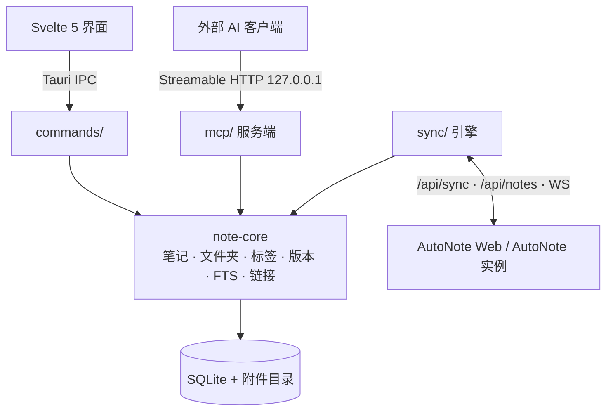

# 03 桌面版设计（AutoNote Desktop）

## 1. 一句话架构

一个 Rust 写的笔记内核 `note-core`，上面接三个入口：图形界面、MCP 服务、同步引擎。三者都只调用内核，任何一方都不绕过内核直接读写 SQLite。



写入规则：每次写入都要在内核里走完同一套流程：计算 `content_hash`、将 `rev` 加一、写入 `changes` 表、更新 FTS 索引、重建链接、保存版本。如果某个入口自己拼 SQL，就会出现"界面上看到的内容"和"MCP 读到的内容"不一致的情况。

## 2. 技术栈（以 AutoBee 为基线）

| 层 | 选型 |
| --- | --- |
| 外壳 | Tauri 2.11.x，Windows 打包为 NSIS，插件：opener、dialog（导入导出）、single-instance、window-state |
| 前端 | SvelteKit 2 + `adapter-static`（SPA fallback）、Svelte 5 runes、Tailwind 4、shadcn-svelte、`@lucide/svelte` |
| 编辑与渲染 | 与 Web 版共用 CodeMirror 6 扩展和 `lib/markdown/*` |
| Rust | edition 2024；rusqlite 0.40 bundled（FTS5）；serde；thiserror；tracing；reqwest（rustls + cookies）；tokio-tungstenite（WS）；axum（MCP HTTP）；sha2；zip；`windows` 0.62.2（DPAPI） |
| 工程 | pnpm、eslint、svelte-check、vitest、clippy（禁止 unwrap/expect/panic、禁止 unsafe）、`scripts/*.bat`（MSVC 环境、dev、build-app） |

## 3. Workspace 分层

| crate | 职责 | 明确不做 |
| --- | --- | --- |
| `note-core` | 领域模型、SQLite schema 与迁移、写入流程、FTS（Rust 版 `segmentCJK`）、链接与反链、版本、附件元数据、导入导出（ZIP/JSON，与 Web 格式互通） | 不依赖 Tauri、不发网络请求 |
| `note-sync` | 远端 HTTP 客户端、cookie 会话、拉取合并、outbox 回放、冲突副本、WS 订阅 | 不依赖 Tauri、不直接访问 UI |
| `note-mcp` | MCP JSON-RPC 服务端（Streamable HTTP）、工具注册、Token 校验、按 scope 限制权限 | 不包含业务逻辑，工具实现全部调用 `note-core` |
| `autonote-shell` | 数据目录、日志、DPAPI 凭据、`AppError` | 不包含业务逻辑 |
| 根包 `autonote` | Tauri command、事件推送、托盘图标、生命周期管理（启动和停止 MCP 与同步） | 不包含业务逻辑 |

`note-core` 单独拆成一个 crate，原因与 AutoBee 相同：写入流程和同步合并的单元测试需要在几十秒内跑完，不能每次都等 Tauri 完整编译一遍。

## 4. 本地数据模型

以 D1 schema 为基础改造：

- 保留：`folders`、`notes`（`rev`、`content_hash`、`deleted_at`、`is_archived` 等）、`tags`、`note_tags`、`links`、`note_versions`、`attachments`、`changes`、`notes_fts`（使用相同的 `unicode61 remove_diacritics 2` 分词）。
- 去掉 `user_id` 列：一个库只对应一个用户，多账号的场景通过切换数据目录实现。
- 删除的表：`users`、`sessions`、`login_attempts`、`totp_*`、`shares`、`share_asset_sessions`、`backup_*`、`ai_*`、`mcp_preferences`（改存到 `prefs`）、`mcp_api_keys`（换成 `mcp_tokens`）、`import_mappings`、`attachment_cleanup`、`fts_index_queue`（本地写入时同步更新 FTS，不需要队列）。保留 `mcp_operations`，用于 MCP 写操作的幂等。OAuth 数据在 Web 版里本来就存放在 KV，桌面版不涉及。
- 新增的表：
  - `sync_state`：远端地址、账号、cursor、上次同步时间
  - `sync_outbox`：记录 op_id、实体、操作、base_rev、载荷、尝试次数
  - `sync_map`：本地 ID 与远端 ID 的映射。由于两端都用同一种 26 位 ID 格式，正常情况下两者相同，这张表只用来处理冲突时生成的副本
  - `prefs`：界面与编辑器设置
  - `mcp_tokens`：Token 哈希、scope、创建时间、最近使用时间
- 附件放在数据目录下的 `files/<id>` 文件里。数据库里的元数据字段与 D1 的 `attachments` 表一致。
- 数据目录固定为 exe 同级的 `data\`（`library.db`、`logs\`、`files\`），不使用 `%APPDATA%`。原因：系统盘重装时数据最容易丢，而且复制整个目录就能完成迁移。代价是安装目录必须可写，所以 NSIS 安装包保持 `currentUser` 模式，不用 `perMachine`（`Program Files` 不可写），用户可以在安装时把目录选到非系统盘。

## 5. 附件路径

笔记正文里的附件链接是相对路径 `/api/files/<id>`，这个格式要保持不变，才能和 Web 版互通。桌面版在渲染层做一次改写：`renderer` 对 `img/src` 和 `a/href` 做后处理，把 `/api/files/<id>` 替换成 Tauri 自定义协议 `autonote-file://localhost/<id>`，由 `register_uri_scheme_protocol` 读取本地文件并返回。笔记源文本本身不做任何修改。

## 6. 同步设计

- 连接：用户填写实例地址、账号和密码，TOTP 作为第二步。登录后拿到的会话 cookie 用 DPAPI 加密后保存。服务端不需要做任何改动。
- 拉取：调用 `GET /api/sync?since=cursor`，按 `hasMore`/`nextKey` 翻页。每一页都在一个本地事务里合并，同时更新 cursor。只有本地没有正文，或者摘要里的 `rev` 与本地不同时，才调用 `GET /api/notes/:id` 拉取正文。
- 推送：本地的每次写入都在同一个事务里追加一条 `sync_outbox` 记录。回放时按 base_rev 调用 `PATCH`：
  - 409：如果服务端返回的正文和标题已经与本地待提交的一致，直接视为已保存。否则把 base_rev 变基到服务端的 rev，保留本地内容后重新提交，也就是本地写入优先。AutoNote 的对应实现见 `store/notes.ts:2201-2248` 的 `rebaseQueuedWrite`，桌面版照此实现，不自行发明三方合并。服务端默认只按 `SNAPSHOT_INTERVAL_MS` 间隔保存版本（`routes/notes.ts:452-462`），所以桌面版在变基后重新提交时要带上 `preserveVersion: true`，确保被覆盖的服务端那一版一定进入版本历史。
  - 404：远端已被删除。桌面版把本地内容恢复为一篇新笔记副本，并根据 `deletionCursor` 清理本地的旧条目，对应 `store/notes.ts:2250-2299`。
- 实时：通过 WS `/api/sync/ws` 收到 `changed{cursor}` 后触发拉取，同时忽略 origin 等于自己 `CLIENT_ID` 的消息。WS 断开后按指数退避重连，最长间隔 30 秒，与 Web 版的 `MAX_BACKOFF_MS` 一致。WS 不可用期间改为轮询，间隔与 Web 版的设置项 `pollIntervalMs` 相同。
- 离线：不配置远端时，同步功能完全关闭，应用作为纯本地笔记使用，不会有任何网络请求。
- 首次绑定：如果本地和远端都有数据，由用户选择"以远端为准""以本地为准"或"合并"。其中"合并"就是先全量拉取，再回放本地的 outbox。

## 7. MCP 设计

- 传输：Streamable HTTP，默认监听 `127.0.0.1:7713`，只接受回环地址的连接。端口被占用时报错，并允许用户修改端口。服务随应用启动，关闭窗口后驻留在托盘继续运行，由设置项控制。
- 认证：请求头 `Authorization: Bearer ink_<43 位 base64url>`，格式与 Web 版 `mcp/api-keys.ts` 的 `KEY_TOKEN_RE` 一致。Token 在设置页生成，只显示一次，库里只存哈希。
- scope：沿用 Web 版的 `read`、`write`、`trash` 三级，外加两个全局开关 `writeEnabled` 和 `trashEnabled`，对应 `server.ts` 里的 `requireScope` 和偏好检查逻辑。
- 工具：Web 版共有 39 个工具。桌面版去掉分享类 3 个（`get_note_share`、`create_note_share`、`revoke_note_share`）和备份类 2 个（`list_backup_runs`、`run_backup`），保留 34 个。保留的工具名称、参数、返回结构和 `instructions` 文案与 Web 版一致，这样同一份 AI 客户端配置两边都能用。
- 写入安全：`edit_note` 等写操作必须带 `expected_rev`；幂等性由 `mcp_operations` 保证，逻辑与 Web 版相同。MCP 写入走的是和界面完全相同的内核写入流程，所以会进入 outbox，界面也能通过 Tauri 事件实时刷新。
- 协议实现：优先评估 `rmcp` 的 server 功能加 streamable-http 传输。如果依赖太重（AutoBee 实测它的 client 端要引入 28 个 crate），就改为手写：只实现 `initialize`、`tools/list`、`tools/call`，再加上会话 ID。这个选型在 M-MCP 阶段的第一个任务里定下来。
- 配置辅助：设置页一键生成 Claude Desktop、Codex、Cursor 所需的 MCP 配置片段。

## 8. 前端结构

```text
desktop/src/
├── routes/+layout.svelte  +page.svelte     # 单页工作台
└── lib/
    ├── ipc/{types,client,tauri-client}.ts  # 状态层只依赖 client 接口
    ├── state/*.svelte.ts                   # notes/ui/prefs/sync/mcp
    ├── components/ui/                      # shadcn-svelte
    ├── features/                           # 从 Web 版拷贝 .svelte，再替换数据源
    ├── editor/  markdown/  shared/         # 与 Web 版同源
    └── styles/
```

Web 版的 `state/*` 通过 `api.ts` 访问 HTTP，桌面版的 `state/*` 通过 `ipc/client.ts` 调用 Tauri。两边的 `features/*.svelte` 只依赖状态类的公开接口，所以组件可以在 `web/` 和 `desktop/` 之间直接复用；稳定后可以提到 `packages/` 下作为共享组件包。

## 9. 桌面版特有功能

- 系统托盘：显示 MCP 和同步状态，提供快速新建笔记的入口
- 全局快捷键：唤出窗口
- 单实例运行：通过 single-instance 插件，避免两个进程同时写同一个 SQLite
- 窗口状态记忆：通过 window-state 插件
- 本地数据导入：AutoNote 的 ZIP/JSON 导出文件、Obsidian 文件夹（`worker/lib/obsidian-import.ts` 的逻辑移植到 Rust）
- 导出：ZIP，格式与 Web 版互通
