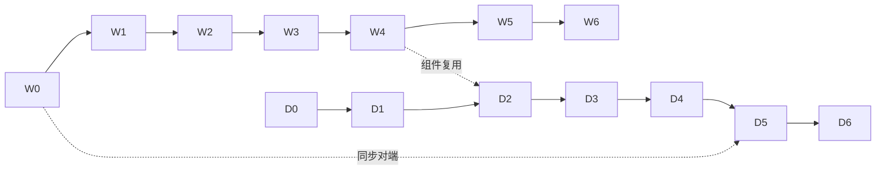

# 04 开发任务清单

> 任务编号规则：`W` 开头属于 Web 版，`D` 开头属于桌面版。每个阶段都有一条可以观察到结果的验收标准，达到后才能进入下一阶段。
> 各阶段的依赖关系：先做 W0 到 W2，D0 和 D1 可以同时进行。D2 要复用 W3 和 W4 做出来的组件。D5 同步功能依赖可运行的 Web 实例（W0 完成即可）。

## Web 版

| 阶段 | 任务 | 验收 |
| --- | --- | --- |
| W0 骨架 ✅ | 1. 建立 `web/`，把 AutoNote 的 `src/worker`、`src/shared`（放到 `packages/shared`）、`wrangler*.toml`、`scripts/e2e.mjs` 原样复制过来，并保留 LICENSE。 2. 用 Vite 8 + cloudflare 插件 + svelte 插件搭一个空的 `App.svelte`。 3. 配置 pnpm、tsconfig 分层（client/worker/node）、`$lib`/`@shared` 别名 | `pnpm dev` 可以启动；`node scripts/e2e.mjs` 全部通过。 实测：e2e 174 项全过，单测 36 项全过。 修掉的 3 个上游 bug： ① `markdownExampleBodies` 在收集 md-example 内容时丢了内层代码块的围栏行，导致代码块里的附件被当成有效引用； ② `rebuildFtsIndex` 重建完没有清掉已经处理过的索引队列，搜索看到队列里还有待处理项，就一直退回 LIKE； ③ e2e 的超限上传用的是写死的 11 MiB，上限在 `5c1549b` 提到 25 MiB 之后它就不再超限了，现在改为从 `LIMITS.attachmentMaxBytes` 推导 |
| W1 基础层 | 1. 复制 styles；在 `index.html` 里内联首屏主题脚本，并统一默认强调色。 2. 把 i18n 改成 runes 写法。 3. 接入 shadcn-svelte，并补齐 Button/Modal/Menu/Drawer/Tooltip/Toaster/表单组件。 4. 写 history 路由，支持 `/s/:slug` 和 `/n/:id`。 5. 把 `i18n:check`、`comments:check` 改为同时扫描 `.svelte`，并加上 eslint 和 svelte-check | 一个组件展示页能切换深浅主题和 7 种强调色；五项质量门全部通过 |
| W2 状态层 | 1. 把 `store/notes.ts` 拆成 `outbox`/`merge`/`mutations` 三个纯模块，并补齐单元测试：409 时确认或变基、404 时恢复成副本、多标签页租约、回滚。 2. 实现 `state/{notes,ui,session}.svelte.ts`。 3. 移植 `sync-engine.ts`（选主、WS、轮询） | 纯模块测试在 node 环境下全部通过；用脚本模拟断网写入后恢复联网，outbox 能正确回放 |
| W3 外壳与导航 | 登录/注册/TOTP、AppShell 三档布局、Sidebar（文件夹树拖拽、标签）、NoteList（分组、多选、增量渲染）、命令面板、全局快捷键 | 桌面、平板、移动三档宽度下都能完成浏览笔记、新建笔记、移动文件夹 |
| W4 编辑与预览 | 1. 编写 `CodeEditor.svelte`，复用 CM6 扩展，并把 live-preview 和 embeds 改为依赖注入。 2. 实现 Workspace 的双窗格、布局切换、双向滚动、大纲、专注模式、打字机模式、阅读位置。 3. 实现 Preview（任务勾选回写、Lightbox）、版本面板、反链面板 | AutoNote 自带的中英文起始笔记在 AutoNote 中渲染结果一致，逐项截图对比 |
| W5 功能补齐 | 设置各分区（外观、编辑器、同步、备份、数据、MCP、TOTP、账号、关于）、分享（设置/公开页）、关系图谱、标签外观、更新提醒、导入导出 | AutoNote README 功能表逐条勾选通过 |
| W6 发布 | PWA（`pwa.config.ts` 适配新的入口 chunk）、demo 模式、`deploy`/`deploy:kv`/`deploy:demo`；用一个已有的 AutoNote 实例升级到 AutoNote 做演练 | 离线状态下能启动和编辑；升级后原有数据和会话仍然可用 |

## 桌面版

| 阶段 | 任务 | 验收 |
| --- | --- | --- |
| D0 骨架 ✅ | 参照 AutoBee 的模板建立 `desktop/`，包括 SvelteKit static、Tauri 2、workspace（`note-core`/`note-sync`/`note-mcp`/`autonote-shell`）、`scripts/`（build-app / clean / dev / cargo-msvc / msvc-env.bat / setup-msvc / msvc-env.sh / smoke-app.mjs）、clippy lint，以及 `verify` 脚本 | `pnpm dev:app` 能打开窗口；`pnpm verify` 通过；`smoke-app.mjs` 6 项通过 |
| D1 内核 | 1. 编写 SQLite schema 和迁移。 2. 实现统一的写入流程：hash、rev、changes、FTS、links、versions。 3. 用 Rust 实现 `segmentCJK`，并与 TS 版做逐字符对照测试。 4. 实现附件存储和 `autonote-file://` 协议。 5. 编写 `ipc/types.ts` 和 `fixtures/ipc-contract.json` | `cargo test -p note-core` 覆盖写入流程的各个不变量；中文搜索结果与 D1 一致 |
| D2 界面 | 从 Web 版拷贝 features 下的组件，编写基于 IPC 的 `state/*.svelte.ts`，实现渲染层的附件链接改写，移除所有与账号相关的界面 | 纯本地模式下能完成笔记、文件夹、标签、版本、回收站、搜索的完整流程 |
| D3 导入导出 | 实现 ZIP/JSON 导入导出（与 `shared/backup-format.ts` 格式一致）和 Obsidian 文件夹导入 | Web 版导出的 ZIP 能导入桌面版，桌面版导出的 ZIP 也能导入 Web 版，往返后内容和附件的哈希一致 |
| D4 MCP | 1. 选定协议实现方案：rmcp 或手写。 2. 实现 Token 管理和 scope 权限。 3. 实现 34 个工具，与 Web 版同名同参。 4. 实现 `mcp_operations` 幂等。 5. 实现设置页，并能生成客户端配置片段 | Claude Desktop 或 Codex 连接后，`search`/`fetch`/`edit_note` 可用；MCP 写入后界面实时刷新；AutoNote `tests/mcp-*.test.ts` 的断言用 Rust 重写后全部通过 |
| D5 同步 | 1. 实现登录（含 TOTP）并用 DPAPI 保存会话。 2. 实现分页拉取与合并。 3. 实现 outbox 回放，处理 409 变基和 404 恢复副本。 4. 实现 WS 订阅和降级为轮询。 5. 实现首次绑定时的三种策略 | 桌面版和浏览器同时编辑同一篇笔记，两边最终内容一致，被覆盖的版本进入历史；断网写入 50 条后恢复联网，全部上传成功 |
| D6 打包 | 托盘、全局唤出、单实例、窗口状态记忆、NSIS 安装包（`currentUser` 模式，可选安装目录）、`build-app.bat` 产出便携 zip、`smoke-app.mjs` 在打包产物上运行 | 在一台干净的 Windows 上安装后能启动；卸载后 exe 旁的 `data\` 保留 |

## 贯穿全程的约定

- 用户可见的文案必须同时在中英文两个语言包中定义键；除 `zh-CN.ts` 以外的源码中不允许出现汉字；代码注释只写英文架构说明。这些都沿用 AutoNote 的 CONTRIBUTING。
- 错误按 `code` 分支处理，不匹配文案；遇到坏输入直接报错，不猜测。这些沿用 AutoBee 概要设计 §4。
- 同一个设置的默认值只能有一个来源，W1 要修复 AutoNote 中强调色默认值不一致的问题。
- `packages/shared` 是 Web 和桌面前端共用的唯一来源，改动它要在同一个 PR 里让两边的 CI 都通过。版本号（`APP_VERSION`）和更新检查源属于 Web 自己，放在 `web/src/release.ts`。
