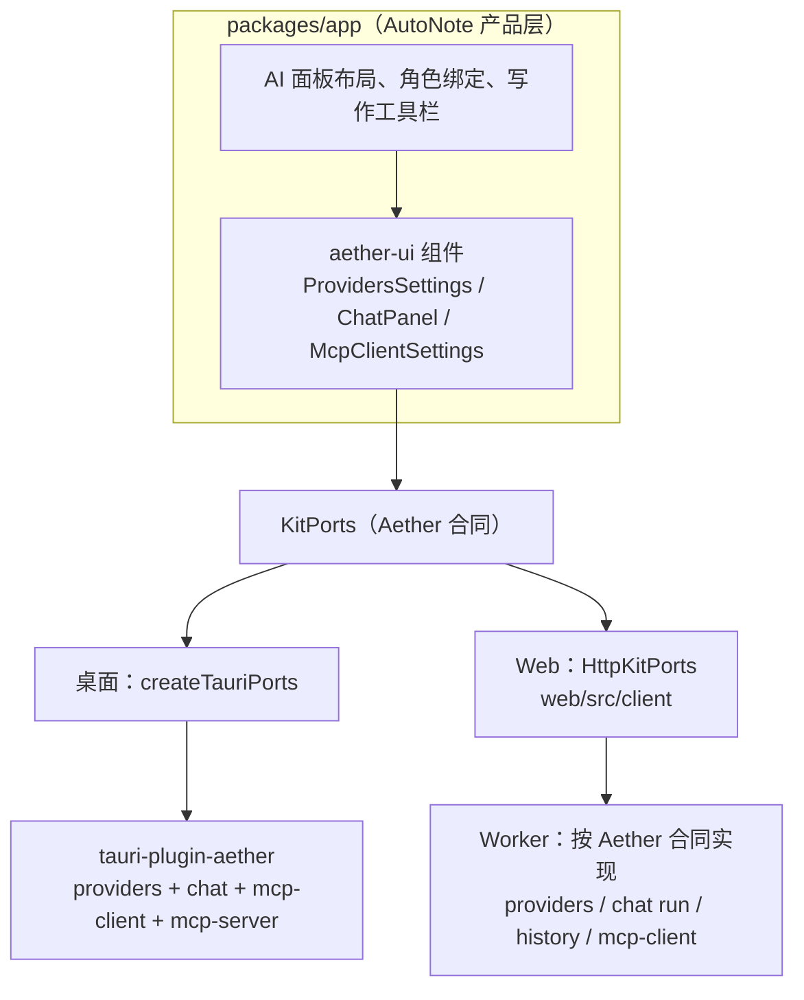
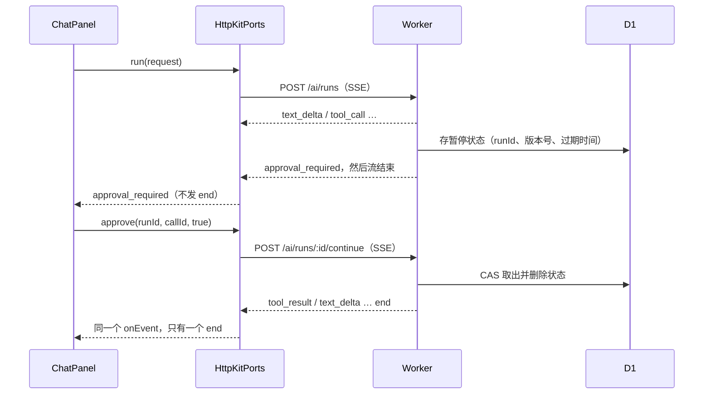

# 26 详细设计：Web 端 AI 界面复用与 Worker 实现

> 状态：方案已确认（2026-10-12），未实施。
> 范围：Web 版与桌面版共用 `@ouraihub/aether-ui` 的 AI 界面；Worker 按 Aether 合同实现服务端；Web 工具审批方式。
> 上游：[24-详细设计-Aether框架迁移方案.md](24-详细设计-Aether框架迁移方案.md)（桌面接入）。本文补充 Web 宿主，二者冲突时以本文的 Web 部分为准。

## 1. 结论

- Web 版 AI 范围：对话、写作、工具调用、MCP 客户端（用户配置并调用第三方 MCP 服务）。
- 两个宿主都用 `aether-ui` 的组件；`packages/app` 只保留 AutoNote 的产品层（布局、角色、写作工具栏、笔记上下文）。
- `aether-ui` **不包含** Web 的 HTTP 适配器和 Worker 服务端；HTTP 适配器 `HttpKitPorts` 放在 AutoNote `web/src/client`。
- Worker 按 Aether 的 DTO 和 `RunEvent` 语义用 TypeScript 实现服务端。这是 24 §2.3「不复制 Provider/Chat/MCP 协议实现」的唯一例外：Worker 无法运行 Aether 的 Rust crate（依赖 reqwest、rusqlite、DPAPI）。
- Web 工具审批用**无状态续跑**，不用 Durable Object（§6）。
- 历史数据沿用 24 §1：Web 端旧 AI 配置和对话不迁移，用户重新配置。

## 2. aether-ui 的定位

标准的端口与适配器分层：

| 层 | 内容 | 位置 |
| --- | --- | --- |
| 合同 | `KitPorts` 及各 port，纯 TS，不涉及传输 | `aether-ui/ports` |
| 组件 | 只依赖 ports，不知道下层是 Tauri 还是 HTTP | `aether-ui/providers`、`/chat`、`/mcp` 等 |
| Tauri 适配器 | `createTauriPorts`，四个桌面程序共用 | `aether-ui/tauri` |
| HTTP 适配器 | `HttpKitPorts` | AutoNote `web/src/client` |
| 服务端 | Worker 路由、D1、鉴权 | AutoNote `web/src/worker` |

HTTP 适配器和服务端不进 `aether-ui`：

- 服务端和应用强绑定：登录、多用户隔离、D1 表结构、Cloudflare 运行限制、密钥加密方式都是 AutoNote 自己的。
- 目前只有 AutoNote 一个 Web 宿主，抽进共享包是过早抽象。出现第二个 Web 宿主时，再把 `HttpKitPorts` 提到 Aether。

`aether-ui` 的组件和合同必须能在浏览器里运行。为此在 Aether 里已做的改动见 §8。

## 3. 曾考虑的方案

| 方案 | 做法 | 结论 |
| --- | --- | --- |
| A | `packages/app` 继续自带 AI 界面，只有桌面后端用 Aether | 不采用：工具调用、审批、MCP 客户端界面要在 AutoNote 再写一遍 |
| B | 两端都用 `aether-ui`，Worker 按 Aether 合同实现 | **采用** |
| C | 桌面用 `aether-ui`，Web 用 `packages/app` | 不采用：同一产品两套 AI 界面，违背两端挂载同一套界面的原则 |

方案 A 原本是首选（Web 只做对话 + 写作时）。Web 范围加入工具调用和 MCP 客户端后，这些界面 `aether-ui` 已有（`ToolCallItem`、`ApprovalCard`、`McpClientSettings`），Worker 也必须实现对应逻辑，照 Aether 合同做最省。

## 4. 目标架构

不变的部分：

- 角色（`chat`、`writing`）、写作工具栏、笔记上下文选择：AutoNote 产品逻辑（24 §2.2）。
- 主题：一段 CSS 把 shadcn 变量（`--background`、`--primary` 等）映射到 AutoNote 的 token，不改 `aether-ui`。
- i18n：`createI18n(locale, overrides)` 覆盖 AutoNote 文案。
- 写作：不用 `ChatPanel`，直接调 `chat.run({ purpose: 'writing', ... })` 处理 `text_delta`（24 §6）。

## 5. 分阶段

| 阶段 | 内容 | 涉及 |
| --- | --- | --- |
| 0 | `ChatPanel` 增加 `context` 参数；`KitPorts.logs` 改为可选（已完成，§8） | Aether |
| 1 | 整理 Aether DTO 的 JSON 样例和 `RunEvent` 事件序列，作为 Worker 对照测试数据；Worker 实现 providers、chat run（不含工具）、history；新增 `HttpKitPorts`；D1 只追加迁移 | Aether + AutoNote Web |
| 2 | `packages/app` 改用 `aether-ui` 组件，两端一次切换；写作工具栏改调 `chat.run`；删除 `AiPort` 合同和桌面适配层 `commands/ai.rs`；桌面 Aether 依赖从 `997d983` 升到含 §8 改动的版本 | AutoNote 两端 |
| 3 | 工具调用：桌面复用 `note-mcp` 34 个工具（`KitHost::tools/call_tool`）；Web 复用 `worker/mcp/operations.ts`；Web 审批按 §6 | AutoNote 两端 |
| 4 | MCP 客户端：桌面打开 `mcp-client` feature、创建 Store、加 capability；Web 在 Worker 实现 Streamable HTTP 客户端，安全要求见 §7 | AutoNote 两端 |

阶段 1 必须先于阶段 2：`packages/app` 两端共用，一换组件 Web 就必须能按 Aether 格式响应。按一次切换、不留兼容层的原则，不能先只换桌面。

防漂移：Worker 的模型分类、SSE 解析与 Rust 实现跑同一批测试数据（Aether `fixtures/model-classify.json`、`fixtures/sse/`）。任一边结果不同，测试失败。AutoNote 的 `fixtures/ai-classify.json` 改为直接用 Aether 那份。

## 6. Web 工具审批：无状态续跑

### 6.1 问题

Aether 约定一次运行一直挂着：模型发出 `approval_required` 后，运行等待 `approve(runId, callId, allow)`，5 分钟（`approval_timeout`）无回应视为拒绝。桌面端同一进程里用 `HashMap<runId, 等待中的 Promise>` 即可。

Worker 每个请求相互独立。审批是另一个 HTTP 请求，可能落到另一个 isolate，找不到正在等待的运行。

### 6.2 两种做法

| | Durable Object | 无状态续跑 |
| --- | --- | --- |
| 做法 | 每次运行对应一个 DO；SSE 由 DO 输出，审批请求路由到同一 DO，在内存里唤醒等待的运行 | 遇到需审批的工具，把这一轮状态（消息、待批调用、轮次、预算、已输出文字）写入 D1 后结束响应；审批时客户端调 `/continue`，服务端读出状态继续 |
| 与桌面语义 | 完全一致 | 服务端不一致；`HttpKitPorts` 包一层后，对组件仍是一次运行、一个 `end` 事件 |
| 手机锁屏、断网 | 连接断开即取消（Aether 规定 Channel 断开即取消），回来时运行已没了 | 状态在 D1，5 分钟内回来仍可审批 |
| 重新部署 Worker | 进行中的运行丢失 | 不受影响 |
| 计费 | 等审批期间 DO 按时长计费；SSE 不能休眠，只有 WebSocket 能 | 多一次 D1 写入 |
| 额外成本 | 几乎没有，项目已有 `SyncHub`、`CredentialVault` 两个 DO | 需保证工具只执行一次（§6.4） |
| Token 成本 | 相同：每轮工具调用本来就是一次独立的模型请求 | 相同 |

### 6.3 选择与理由

采用无状态续跑。

- 主流框架都采用「暂停时结束请求、把状态存起来、审批后从存储恢复」，没有一家在审批期间让请求或进程一直挂着（2026-10-12 核对官方文档）：

  | 框架 | 做法 | 状态存在哪 |
  | --- | --- | --- |
  | [Vercel AI SDK](https://ai-sdk.dev/docs/ai-sdk-core/tools-and-tool-calling) | `streamText` 不暂停，直接结束并返回 `tool-approval-request`；应用把 `tool-approval-response` 追加进消息后再调用一次，批准则执行工具。审批配置用 `toolApproval`（旧的 `needsApproval` 已弃用） | 消息数组本身，由应用保存 |
  | [OpenAI Agents SDK](https://openai.github.io/openai-agents-js/guides/human-in-the-loop/) | 运行暂停并返回 `interruptions`；`result.state.toString()` 序列化，之后 `RunState.fromString(agent, saved)` 恢复。文档明确写明长时间审批不需要服务进程一直运行 | 应用自选（文件、数据库） |
  | [Cloudflare Agents](https://developers.cloudflare.com/agents/concepts/agentic-patterns/human-in-the-loop/) | Code Mode：记录待批调用后中止，批准后从持久日志重放已完成的调用再继续；长审批用 Workflows `waitForApproval()` | Durable Object 存储、Workflows |

- Cloudflare 的方案同样是「中止 + 持久化 + 恢复」，Durable Object 在其中是**存储位置**，不是让运行在内存里等待；它的待批状态能扛过请求结束和 DO 休眠。AutoNote 用 D1 存这份状态即可，不需要为此引入每次运行一个 DO。
- 什么时候才值得用 DO：多设备同时观看同一次运行，或断线后服务端仍要继续跑。AutoNote 两者都不需要。
- Web 用户常在手机上使用、经常锁屏，项目又频繁部署，无状态续跑更稳。
- 桌面端不用改，Aether 的 `ChatPort` 合同不用改；变化只在 Worker 和 `HttpKitPorts`。

### 6.4 流程与规则

- 只执行一次：状态行带版本号，取出时按版本 CAS 删除；双击"允许"、重复请求只有一次能取到。
- 过期：状态过期时间等于 `approval_timeout`（5 分钟）；过期后续跑按拒绝处理，与桌面一致。
- 停止：等待审批时用户点"停止"，`HttpKitPorts` 调取消接口删除状态，再发出 `end: cancelled`。
- 历史完整：暂停前已输出的文字写入状态，续跑结束后整轮写入会话历史。
- 不需要审批的工具在同一请求里直接执行，不暂停。
- 状态按用户隔离：续跑和取消都校验 `user_id`。

## 7. Web MCP 客户端安全要求

调用第三方 MCP 服务是安全边界，不做简化：

- 防 SSRF：只允许 `https`；拒绝内网、回环、链路本地 IP 字面量；不跟随重定向。
- 凭据：用现有 `encryptCredential`（`web/src/worker/lib/crypto.ts`）加密存储，不回显明文。
- 外部内容：外部工具结果像 Aether chat 一样包装为外部内容再交给模型，防提示注入。
- 审批：非只读工具默认需要审批。
- 上限：单次响应大小、每轮工具调用数、总轮数都有上限。

## 8. 已在 Aether 完成的改动

| 提交 | 内容 |
| --- | --- |
| `adf2c6c fix(ui): invoke plugin:aether commands` | `packages/ui/src/tauri/index.ts` 原来调 `plugin:kit\|…`，Rust 插件注册名是 `aether`，真实窗口里每个命令都会失败 |
| `366bec7 feat(ui): ChatPanel host context chip; logs port optional for browser hosts` | `ChatPanel` 新增 `context` 参数（可移除标签，× 只影响下一条消息）；`KitPorts.logs` 改为可选，缺省时日志面板不渲染；`createTauriPorts` 返回类型仍保证有 `logs` |

验证：Aether `pnpm run check` 通过，37 项测试。未在真实 Tauri 窗口验证。

## 9. 阶段 1 实施合同

> 2026-10-12 读代码后制定。依据：Aether `crates/aether-providers`、`crates/aether-chat`、`plugin/tauri-plugin-aether/src/chat.rs`、`packages/ui/src/ports`；AutoNote `web/src/worker/routes/ai.ts`、`web/src/worker/db/schema.ts`、`web/src/client/backend/ports/ai.ts`、桌面 `desktop/src-tauri/src/lib.rs` 的 `AetherHost`。

### 9.1 现状盘点（避免重复实现）

| 项 | 现状 | 阶段 1 处理 |
| --- | --- | --- |
| Aether DTO / `RunEvent` 的 JSON 样例 | 不存在。只有 `fixtures/model-classify.json`（36 条）和 `fixtures/sse/` 18 份上游流样本；Rust 测试的期望值写在测试代码里 | 新增，见 9.4 |
| Worker `/api/ai/runs`、`HttpKitPorts`、`KitPorts` | 不存在 | 新增 |
| Worker 旧接口 `/api/ai/providers`、`/endpoints/:id/*`、`/roles`、`/conversations`、`/chat`、`/write` | 存在，旧 `AiPort` 合同，`packages/app` 仍在用 | 阶段 1 保留不动；阶段 2 切换界面时一次删除 |
| D1 AI 表 | `ai_providers`、`ai_endpoints`、`ai_models`、`ai_roles`、`ai_conversations`、`ai_messages`，写在最终 `SCHEMA_STATEMENTS`，迁移号最高 12 | 见 9.2 |
| 密钥加密 | `encryptAiKey`/`decryptAiKey`（`web/src/worker/lib/crypto.ts`），经 `CredentialVault` DO | 直接复用 |
| 上游 SSE 解析 | `extractDelta` 只取文本，不取 usage、不判截断、不区分流内错误 | 新写一个按 Aether 映射的解码器，旧的阶段 2 删除 |
| 私网地址策略 | `assertSafeUrl` + `app_meta` 开关 `setting:ai_allow_private` | 复用 |
| 桌面宿主逻辑 | `AetherHost`：`purpose` 只允许 `chat`/`writing`；上下文 `autonote-note`；写作作用域 `note:<id>:writing` 且不存会话；角色 `writing` 回落 `chat` | Worker 照搬同一套规则 |

### 9.2 存储

沿用 24 §1：不迁移旧数据。新增迁移 13：

- `ai_models` 增加 `max_output INTEGER`、`supports_tools INTEGER`（NULL 表示未知），对齐 Aether `Model`。
- 新表 `ai_chat_conversations(id, user_id, title, scope, created_at, updated_at)` 与 `ai_chat_turns(id, user_id, conversation_id, seq, status, input, messages, model_id, error_code, input_tokens, output_tokens, created_at)`，字段语义对齐 Aether `chat.db`，加 `user_id` 隔离。
- 旧 `ai_conversations`、`ai_messages` 阶段 2 删除旧接口时一并删除。

### 9.3 新接口（`/api/ai/kit/*`）

与旧接口并存到阶段 2，路径前缀区分，鉴权沿用旧路由（登录 + `owner`）。

| `KitPorts` 方法 | 接口 | 说明 |
| --- | --- | --- |
| `providers.list` | `GET /providers` | 返回 `Provider[]`，`keyMasked` 打码，`keyReadable` 恒 true |
| `providers.save` | `PUT /providers` | `ProviderSave` 整体替换；密钥三态（省略保留、空串清除、非空替换）；校验规则照 Aether `store.rs` |
| `providers.remove` | `DELETE /providers/:id` | 返回剩余 `Provider[]` |
| `providers.modelOptions` | `GET /model-options?modelType&supportsTools` | 标签 `服务商 · 线路 · 模型` |
| `providers.probe` | `POST /probe`，body `ProbeTarget` | 上游失败作为 `ProbeResult.error` 返回，不报请求错误 |
| `chat.run` | `POST /runs`，body `RunRequest`，返回 SSE | 第一条事件 `accepted{runId,conversationId}`，之后是 `RunEvent`，最后恰好一个 `end` |
| 取消 | 客户端中止 fetch | 服务端感知断开后停止读上游，回合记为 `cancelled` |
| `chat.approve` | 阶段 1 不实现 | 阶段 3 按 §6 |
| `chat.history.*` | `GET /conversations?scope`、`GET/DELETE /conversations/:id`、`PATCH /conversations/:id` | 规则照 Aether `store.rs`：最多 200 条、按 `updated_at` 倒序、标题 40 字符 |

请求错误（运行被接受前）返回 HTTP 4xx/5xx + `{ error: KitError }`，不开 SSE；运行被接受后的失败只走 `end{status:'failed', error}`。

### 9.4 共享测试数据

共享数据放在 Aether npm 包内，宿主经 git 依赖安装后即可读取（`@ouraihub/aether-ui/fixtures/*`）：`fixtures/sse/<protocol>/<case>.sse` 是上游流样本；`fixtures/sse/expect.json` 是每份无工具样本的期望结果（文本、usage、终态、错误码与错误信息片段）；`fixtures/model-classify.json` 是模型推断用例。Rust（`aether-chat`、`aether-support`、`aether-providers` 测试）与 Worker（`web/tests/ai-kit.test.ts`）读同一份文件断言，一边改了解析逻辑而另一边没改就会失败。

### 9.5 不做

- 工具调用、审批、`chat.approve`（阶段 3）；MCP 客户端（阶段 4）；技能（Web 不启用，`skills` 非空返回 `unsupported`）。
- 不改 `packages/app` 界面，不删旧接口（阶段 2）。
- 角色接口：Aether 没有角色端口，Worker 继续用 `ai_roles` 表做 `select_model`；角色设置界面阶段 2 由 AutoNote 产品层用 `ModelSelect` 实现。

### 9.6 完成情况（2026-10-12）

| 项 | 位置 | 验证 |
| --- | --- | --- |
| 共享测试数据 | Aether `1e97487`：fixtures 移入 `packages/ui/fixtures`，新增 `expect.json` | Rust 3 个 crate 测试与 clippy 通过 |
| 依赖 | `web/package.json`：`@ouraihub/aether-ui` git 依赖锁 `1e97487` | Worker 与客户端类型检查可解析 |
| D1 迁移 13 | `web/src/worker/db/schema.ts` | 测试经 `initializeDatabase` 建库 |
| Worker | `web/src/worker/ai/{kit,infer,protocol,providers,history,runs}.ts`、`web/src/worker/routes/ai-kit.ts`，挂在 `/api/ai/kit` | `web/tests/ai-kit.test.ts` 26 项，用 `node:sqlite` 实现的 D1 适配器跑真实 SQL |
| 客户端 | `web/src/client/backend/ports/kit.ts`（`createHttpKitPorts`）、共享 SSE 读取器 `web/src/client/backend/sse.ts` | `kit.test.ts` 7 项 |
| 整体 | — | `pnpm run web:check` 通过；web 单测 29 个文件 135 项通过；本地 dev 服务器（Worker + 本地 D1）实测服务商保存、密钥打码、探测（私网拦截、连接失败）、运行前请求错误 |
| 真实上游 | 本地 dev 服务器（`@cloudflare/vite-plugin`，Worker 运行在 workerd + 本地 D1），中转 `api.easyclaude.com` | 三协议各跑一遍：`anthropic-messages`（`claude-haiku-4-5-20251001`）、`openai-chat` 与 `openai-responses`（`gpt-5.5`）。每种都验证：探测得到 17 个模型；新对话事件顺序 `accepted → round_start → text_delta → usage → end{completed}`，`end` 恰好一个且在最后；续聊带上历史（第二轮正确翻译上一轮回复）；重新生成复用最后一轮；历史 2 轮均 `completed`；流式中途断开后该轮记为 `cancelled` 并保留已输出文本；删除会话和服务商后无残留。另用失效密钥验证 401 → 探测 `unauthorized` + `check_key` 提示、运行 `end{failed, unauthorized}` |

与 Aether 的差异：

- 地址策略沿用旧接口：只允许 `https`，私网主机按字面拦截（`setting:ai_allow_private` 可放开）；Aether 允许 `http://localhost`。Worker 无法在连接时检查 DNS 结果。
- `KitErrorCode` → HTTP 状态：`bad_request`/`unsupported`/`budget_exceeded` 400，`unauthorized` 401，`forbidden` 403，`not_found` 404，`conflict`/`needs_config`/`cancelled` 409，`rate_limited` 429，`upstream`/`network` 502，`timeout` 504，其余 500。客户端只看响应体里的 `code`。
- `running` 状态超过 15 分钟的轮次读作 `failed` + `interrupted`（Worker 无法恢复中断的运行）；重新生成会刷新该轮 `created_at`。
- `keyReadable` 按能否解密计算；`CredentialVault` 不可用时列表不报错，探测和运行返回 `needs_config{reason:'key_unreadable'}`。

未验证：

- 部署到 Cloudflare 线上环境后的运行（本地 workerd 已验证断开取消与 `waitUntil` 终态写入）。
- 120 秒首包、60 秒空闲超时未有测试实际触发。
- `web/tests/` 不在任何 tsconfig 内，测试文件本身不经类型检查（由 vitest 运行）。

## 10. 阶段 2 完成情况（2026-10-13）

两端 AI 界面已切到 `@ouraihub/aether-ui`（锁 Aether `666c266`），旧 AI 栈一次删除。AutoNote 6 个提交 `512a95c..82e9e72`，净删约 3600 行。

### 10.1 结构

- 宿主合同 `AiHostPort`（`packages/app/src/backend/port.ts`）：`kit: KitPorts` + AutoNote 自有的 `roles/setRole`（chat、writing，writing 回落 chat）+ `revealKey(endpointId, currentPassword)` 与 `revealNeedsPassword`。Web 用 `createHttpKitPorts`，桌面用 `createTauriPorts`。
- `AppRoot` 在有 `aiHost` 时调用 `provideKitContext`：i18n 跟随 AutoNote 语言，notify/confirm 走 AutoNote 通知，logger 用 AutoNote 日志。
- 设置：aether `ProvidersSettings` + AutoNote 角色区（aether `ModelSelect`）+ 显示密钥区（Web 先输当前密码）。
- 对话：aether `ChatPanel`，`scope` 为 `note:<id>`（无笔记时 `autonote`），`context` 为 `{kind:'autonote-note', id, label}`；按 scope 记住上次会话（AutoNote prefs `ai.chat.last:<scope>`）。
- 写作：保留 AutoNote 工具栏，改调 `kit.chat.run({ purpose: 'writing', ... })`，输入 JSON 与桌面 `validate_writing` 一致；不写会话历史。
- 样式：AutoNote `ui.css` 引入 `@ouraihub/aether-ui/tokens.css` 并 `@source` aether 源码，不引入 `styles.css`；颜色沿用 AutoNote 的 `@theme inline` 映射，暗色变体匹配 `data-theme`。
- Vite：`optimizeDeps.exclude: ['@ouraihub/aether-ui']`（Web、桌面）。aether-ui 以源码发布，Vite 预打包解析不了其中的 `.svelte.ts`。

### 10.2 删除

- `packages/shared/src/ai-types.ts`、`ai-classify.ts`；`Backend.ai` 与 `AiPort`；`packages/app` 的 `EndpointCard`、`ModelPickerDialog`、`chat-session`。
- Web：`HttpAiPort` 及测试；Worker 旧接口（providers、probe、conversations、chat、write），只保留 `GET/PUT /api/ai/roles` 与 `POST /api/ai/endpoints/:id/key`；D1 迁移 14 删除 `ai_conversations`、`ai_messages`。
- 桌面：`desktop/src/lib/{chat,settings/ai,writing}` 死代码副本、`ipc/ports/ai.ts`、transport 里的 `aiChat/aiWrite/#chatHistory`；Rust `ai_providers_list/save/delete`、`ai_endpoint_probe` 命令。桌面主窗口新增 `aether:providers` 权限。

### 10.3 顺带修复

- Web 显示密钥此前一直失败：Worker 要求当前密码，旧前端发空 body，恒为 401。现由界面收集密码。
- 打开笔记即崩溃（`effect_update_depth_exceeded`）：`NotePane` 的 `onViewReady` 在 CodeEditor 挂载 effect 里递增 `editorGeneration`，effect 读写同一状态。改为 `untrack`。来自 `bab490b`，已有的双窗格工作区测试此前就失败，修复后通过。

### 10.4 验证

- `pnpm run app:check`、`pnpm run web:check` 通过；app 测试全过（含此前失败的工作区测试）；web 单测 27 个文件 131 项；桌面 vitest 13 项；桌面 Rust `clippy --workspace --all-targets -D warnings` 与 `test --workspace` 通过。
- Web（本地 dev 服务器 + workerd + 本地 D1，真实中转 `api.easyclaude.com`，`gpt-5.5`）：设置页显示服务商与角色，控件 30px/13px/8px 圆角与 AutoNote 一致；显示密钥错误密码提示"当前密码不正确"，正确密码显示完整密钥，关闭后清除；对话带笔记上下文回答，插入到笔记、刷新后恢复会话、删除会话（确认对话框）均正常；润色生成预览并显示"使用对话模型"回落提示，写作不写入会话历史；旧 `/api/ai/providers` 返回 404。
- 桌面（`custom-protocol` 构建的真实 exe，放在隔离目录，WebView2 CDP 驱动）：设置页同上且无密码框，显示密钥直接成功；对话带笔记上下文回答；润色正常；旧命令 `ai_providers_list` 已不存在；完全退出重启后会话恢复。
- 测试数据（服务商、会话、角色、测试笔记）均已删除；临时脚本与隔离目录已清理。

### 10.5 已知问题

- 新建笔记后立即打开对话，上下文标签显示"未命名笔记"，标题解析晚于面板挂载；发送的内容是正确的。
- `claude-haiku` 经此中转时不遵循 AutoNote 系统提示词（自称其他身份），gpt 模型正常；疑为中转在 Claude 线路注入了自己的提示词，未核实。
- 未验证：部署到 Cloudflare 线上；macOS 桌面。

### 10.6 密钥操作区布局修复（2026-10-13）

- 长密钥掩码原本把“替换 / 清除”按钮挤出线路卡片。`SecretInput` 改为可收缩的单行布局，中间省略、保留首尾四字符，按钮不收缩；替换输入和清除撤销状态沿用同一宽度约束。
- 小屏时 `ProvidersSettings` 的服务商列表移到表单上方，不再占用固定侧栏宽度。
- AutoNote 用 `patches/@ouraihub__aether-ui@0.1.0.patch` 持久修补已锁定的 Aether UI 包；`pnpm-workspace.yaml` 注册补丁、锁文件记录补丁摘要。Web 和桌面共同生效，不依赖临时修改 `node_modules` 或发布上游提交。以后升级到包含此修复的 Aether 版本时，移除补丁及其注册并重新生成锁文件。
- 真实 Chromium + 本地 Worker 实测 320/375/414/768/900/1280px：204 字符测试密钥的掩码行无横向溢出，两个按钮均在卡片边框内；替换/取消、清除/撤销、保存清除和保存新密钥的接口读回均通过。桌面复用该组件，正式桌面窗口本次未重跑。

### 10.7 获取模型弹窗优化（2026-10-13）

- 参考 Voynote 的 `ModelPicker.svelte`：移除全选和逐行复选框，未选模型用 `+` 添加，已选模型用 `−` 移除并显示“已选”。增加不区分大小写的 ID 搜索、分类数量、分组数量与折叠、可看图能力提示，批量添加/移除仅作用于当前筛选结果。
- 保留 AutoNote 的草稿语义：取消或 Esc 不应用选择，确认后更新服务商草稿，仍需保存服务商；重新打开会重置搜索和筛选。模型类型改为无边框的轻量下拉，仍能人工修正分类，保留用户指定的类型来源。
- 修改已并入 `patches/@ouraihub__aether-ui@0.1.0.patch`，Web/桌面共用，冻结锁文件安装通过。Aether lint/format/typecheck 与 47 项测试通过，两宿主类型检查 0 错误/警告。
- Chromium 实测 320/375/414/768/1280px：模型行无横向溢出，只有模型列表纵向滚动、底部按钮在弹窗内；加减、过滤批量增删、搜索空结果、分组折叠及搜索展开、取消恢复、Esc 关闭均通过。确认并保存后从真实本地 Worker 读回模型及人工修正的 `modelType/typeSource`。
- 模型探测响应使用明确的浏览器路由测试数据，不调用真实模型供应商；此次验证界面和保存链路，不宣称上游获取模型或正式桌面窗口已联验。隔离测试服务与数据已清理。

