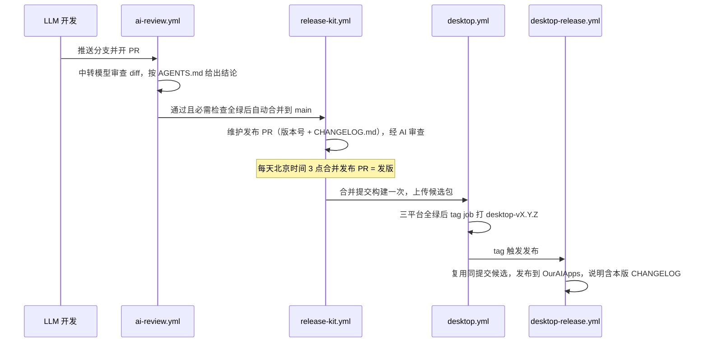

# 42 版本管理、提交规范与发布流程

状态：已定稿（2026-10-21）。工具 [ouraihub/release-kit](https://github.com/ouraihub/release-kit) 可复用于其他项目。

决定：提交标题和 CHANGELOG 用中文；0.x 阶段 `feat` 升 patch；Web 不纳入版本号；不合规提交 CI 直接失败。

## 1. 发布流程

| 文件                                | 作用                                                                                                |
| ----------------------------------- | --------------------------------------------------------------------------------------------------- |
| `release-please-config.json`        | 版本文件：`desktop/package.json`、`desktop/src-tauri/Cargo.toml`、`Cargo.lock` 中的本地包；中文分组 |
| `.release-please-manifest.json`     | 已发布版本；只由发布 PR 修改                                                                        |
| `release-kit.json`                  | tag 前缀 `desktop-v`、禁用词                                                                        |
| `.github/workflows/release-kit.yml` | 维护发布 PR                                                                                         |
| `desktop.yml` 的 `tag` job          | 构建全绿后给发布 PR 的合并提交打 tag（其他提交跳过）                                                |
| `.github/workflows/ai-review.yml`   | 审查 PR 并在通过后开启自动合并；审查逻辑在 `ouraihub/release-kit/review@v0`，测试也在 release-kit |

- 版本号只剩两处：`desktop/package.json` 和 Cargo workspace。`tauri.conf.json` 不写版本，Tauri 回退读取 Cargo 版本；`desktop-kit version`（`forbidTauriVersion`）拦截第三份副本。
- 构建、候选包、发布、清理由共用工具 [desktop-kit](https://github.com/ouraihub/desktop-kit) 完成，AutoNote 只在 `desktop/package.json` 的 `desktopKit` 写配置。`desktop-kit build` 依次做版本检查、verify、`tauri build`、收集并校验候选包；任何子进程失败立即中止，不产出候选包。发布说明的"更新内容"由 `release-kit notes` 提供，desktop-kit 不重复解析 CHANGELOG。
- `package:verify` 由完整 CI 在桌面验证后调用 `desktop-kit build --skip-verify`，避免重复验证；单独 `build:app` 仍默认运行桌面验证。
- 本地提交前只强制受影响模块的检查、测试与真实运行；`pnpm run ci` 是可选的完整本机入口。PR 的 Web job 集中运行共享检查、Web 测试和构建，Web e2e 独立执行；Desktop 三平台运行 `pnpm run ci:desktop`，不重复 Web 或共享静态检查。必需检查名称与分支保护不变。
- Desktop 三平台构建只在会影响桌面产物时运行。job 始终运行并上报结果，由 `scope` 步骤按 diff 内容（不看分支名、作者）决定是否跳过后续步骤：
  - PR 只改了 `web/`、`docs/`、根目录 `*.md`、`.github/scripts/`、`web.yml`/`ai-review.yml`/`release-kit.yml` 时跳过。名单之外的任何文件都会构建，新增文件默认构建。
  - 除上述文件外只改了版本文件，且每一行改动都是把新旧发布版本号写入版本字段（release-please 的发布 PR）时跳过。改了依赖、脚本或代码的照常构建。
  - main 的 push 只在 `.release-please-manifest.json` 变化时运行，也就是发布 PR 合并的时候。PR 阶段跳过的改动在这里完整构建，失败就不打 tag、不发布。
- 发布 PR 每天合并一次（`release-kit.yml` 的定时任务，北京时间 3 点；也可手动运行该工作流立即发版），当天的所有合并共用一次发版构建。当天没有新的 `feat`/`fix`/`perf`/`revert` 时没有发布 PR，不发版。ai-review 不自动合并 `release-please--*` 分支。
- 新提交取消同一 PR 的旧运行。发布仍复用同一提交、同一 run 的绿色候选包，不用本地包替代远端候选。
- Rust 缓存只在 main 上保存，PR 只读取；CI 关闭 dev/test 的 debuginfo（增量编译由 rust-cache 关闭），release profile 不受影响。`verify` 不单独跑 `cargo check`，由 `clippy --all-targets` 覆盖。
- 只有 `feat`/`fix`/`perf`/`revert` 进入 CHANGELOG，`chore`/`docs`/`ci` 等不进入。
- 需要的仓库设置：Actions 允许创建 PR；允许自动合并，只开"合并提交"方式（squash 会把多条提交压成一条，CHANGELOG 丢条目）；合并后自动删除分支（`delete_branch_on_merge`），发布 PR 分支下次由 release-please 重建；`RELEASE_TOKEN` 打 tag、开发布 PR 并执行合并（`GITHUB_TOKEN` 开的 PR、做的合并、打的 tag 都不触发后续工作流）。
- main 分支保护：禁止直推和强推，必需检查为 `Commit rules`、`Web check`、`Web e2e`、`Build (windows)`、`Build (macos)`、`Build (linux)`、`AI review`。PR 上的 Web/Desktop 不用 `paths` 过滤触发，否则被过滤掉的必需检查会一直等待；Desktop 的按路径跳过只发生在 job 内部的步骤上。
- AI 审查：中转地址、密钥在仓库 secret `AI_BASE_URL`、`AI_API_KEY`，模型在变量 `AI_MODEL`。工作流和脚本从 main 读取（`pull_request_target`），PR 改不了自己的审查；PR 代码只作为文本读取，不执行。大 diff 按完整文件分批，每批最多 12 万字符；全部批次通过后，还必须把全部原始补丁交给同一次跨文件一致性审查，不用摘要替代代码。单文件超限、任一审查拒绝、上下文不足、结论无效或请求失败均不合并，不截断内容。改动 `.github/`、`AGENTS.md` 时从严，fork 的 PR 一律不通过。

已知限制：

- Desktop 在 main 上排队而不取消，但同组只保留一个等待中的运行。两次发布合并挨得太近时，前一个合并提交的构建可能被跳过，需要在 Actions 里手动重跑一次，tag job 会补打 tag。
- 分支保护不要求 PR 先同步最新 main，main 上也不再逐次构建。两个各自通过的 PR 合在一起才出现的问题，要到下一次发布合并时才会被发现；此时构建失败不会发版，修复后由下一个发布 PR 带上。
- 0.2.1 之前的提交不进 CHANGELOG，起点是已有 tag `desktop-v0.2.1`。
- AI 审查只在 PR 打开、推送新提交时运行。中转超时或报错时检查直接失败，不会自动重试；用 `gh run rerun <run-id> --failed` 重跑即可，不用改代码。模型只看到 diff 和 AGENTS.md，看不到未改动的上下文文件。

## 2. 提交和注释规范

评审样本：AutoNote 最近 99 条、Aether 最近 77 条提交。格式全部是 Conventional Commits，问题出在内容：

| 问题                   | 例子                                                                          | 处理                            |
| ---------------------- | ----------------------------------------------------------------------------- | ------------------------------- |
| 一条塞多件事、标题过长 | Aether 有 17 条超过 72 字符，最长 103                                         | 检查拦截超长标题                |
| 正文复述 diff          | `D1 v28: ai_models name/group_name/pricing…`、`Pin Aether b86431b (4 places)` | 正文最多 6 行                   |
| 写参考项目名           | `Cherry-style model settings`；Aether 代码注释 17 处                          | 提交和代码都检查，Aether 已清理 |
| 验证记录、AI 署名      | `Verified:`、`Co-authored-by: Claude`                                         | 检查拦截                        |
| 标题与内容不符         | `5bed8c6`（变基后已不含引用变更）                                             | 规则：推送前合并同一问题的修补  |

用真实 release-please 对 0.2.0→0.2.1 的历史做了一次干跑，生成的 CHANGELOG 第一条是"Cherry-style model settings with end-to-end effect"，第二条是标题与内容不符的 `5bed8c6`。这正是规范要解决的问题：提交标题就是用户看到的更新日志。

规则全文见 [release-kit 规则](https://github.com/ouraihub/release-kit#规则)，AGENTS.md §6 有摘要。检查是本地 `pnpm run ci` 的第一步；远端由 `release-kit.yml` 在每次推送和 PR 时执行，不受路径过滤影响，纯文档提交也会检查。只检查上游之后的新提交，不改写历史。

## 3. LLM 开发流程评审

项目主要由大模型开发和维护。下表列出本轮实际遇到的问题，以及对应措施。

| 问题（证据）                                                                                                  | 根因                                                                         | 措施                                                                       | 状态     |
| ------------------------------------------------------------------------------------------------------------- | ---------------------------------------------------------------------------- | -------------------------------------------------------------------------- | -------- |
| 提交冗长、写参考项目名                                                                                        | 模型按"汇报工作"的习惯写提交；规则只有文字没有检查                           | `release-kit check` 在 CI 失败                                             | 已落地   |
| 代码注释写"参考 xx 实现"：Aether 17 处，AutoNote 0 处                                                         | AutoNote 有注释白名单检查，Aether 没有                                       | 两个仓库都做禁用词扫描                                                     | 已落地   |
| 改版本号的时机错误，导致重复打包                                                                              | 流程靠人记，模型不知道版本号已编进安装包                                     | 发布 PR 和自动打 tag 接管                                                  | 已落地   |
| 任务清单与代码脱节：`docs/03` 有 49 项未勾选，审计时其中多数已经实现、只差验收                                | 不同模型完成工作后不回写清单；清单依赖人工勾选                               | 建议：清单每项只写状态和判据命令，完成以 CI/验收命令通过为准，不写过程叙述 | 待确认   |
| 设计文档混入执行日志：`docs/` 共 7,968 行，其中 101 行是"日期 + 验证/通过"记录；`docs/03` 有 11 行超过 400 字 | 模型把每轮验收写回设计文档；文档越写越长，过期记录误导后续模型，也占用上下文 | 建议：验证记录写进 PR 描述和 CI，设计文档只写现行设计；历史靠 git 追溯     | 待确认   |
| 规则分散：AGENTS.md 35 行，`docs/04` 245 行，另有各设计文档                                                   | 模型很难读全，遗漏后只能靠评审发现                                           | 原则：能写成检查的规则就做成检查，AGENTS.md 只保留硬规则                   | 持续执行 |

后两项涉及大量删改现有文档，需要你确认后再分批做。每批只动一个文档，不在同一个提交里混入代码。
